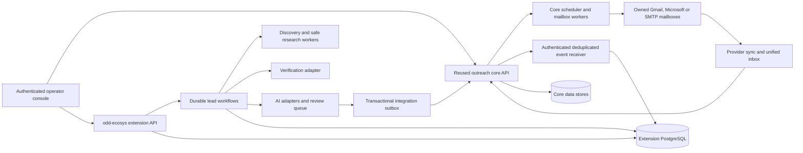

# GLM 5.3 Orchestrator — odd-ecosys Production Implementation

**Version:** 1.0 · **Prepared:** 6 October 2026  
**Repository inspected:** `E:\project\odd-ecosys`  
**Deliverable:** Implement and validate the complete scoped outreach platform below, reusing established open-source projects. Work through one numbered phase at a time. Keep durable progress and evidence so another session can resume accurately.

> A Markdown file does not execute code or establish production readiness. Load this file into a coding agent with repository, terminal, browser, and test access. The agent must actually implement the work and run the gates. Zero defects and guaranteed inbox placement cannot be promised; the enforceable target is complete requirement coverage, truthful behavior, passing evidence, and explicit release blockers. This document contains a source audit and an implementation mandate; it does not claim the current project has passed these gates.

## 1. Start instruction for the coding agent

Use this entire document as the task specification. The human's request authorizes implementation, local development, isolated integration testing, and preparation of deployment artifacts. Production publishing, paid subscriptions, production data deletion, and external outreach require existing explicit authorization and the appropriate credentials. Continue all independent local work while required external inputs are unavailable.

```text
You are the implementation agent for odd-ecosys.
Read ORCHESTRATOR_GLM_5_3.md completely before editing.
Then inspect the actual repository and applicable repository instructions.
Execute P00, then P01, then the remaining phases in dependency order.
Do the implementation and run the tests; a written plan is not task completion.
Use open-source services and libraries before writing equivalent infrastructure.
Remove production simulations, fabricated metrics, and silent success fallbacks.
Never represent missing credentials, an unavailable provider, an unrun test,
an SMTP acceptance, or a heuristic as a verified successful outcome.
Maintain the requirement ledger, task ledger, evidence, and resume checkpoint.
Do not reduce scope, skip a requirement, or mark a failed test passed.
If blocked by an external dependency, record it honestly and complete the
independent work; production readiness remains false until its gate passes.
After a phase passes, proceed to the next phase in this active session.
If the harness interrupts you, persist the exact next action for the next turn.
Do not stop after scaffolding, UI polish, partial integrations, or test stubs.
Finish only when all release gates pass, or report the exact remaining blockers.
```

GLM 5.3 is the intended coding agent. Do not assume an undocumented GLM API, model identifier, context limit, scheduler, or tool contract. Follow the actual harness settings. Persist files before context compaction. Continuation requires the harness to run another turn; do not claim this document schedules itself.

## 2. Non-negotiable implementation rules

1. **Production contains no pretend outcomes.** Missing SMTP/OAuth credentials means disconnected or blocked. No random sends, bounces, opens, deliveries, health evidence, costs, screenshots, verification results, CRM confirmations, or billing success.
2. **Unknown is a real state.** Model/provider/network failure means unavailable, unknown, retryable failure, or awaiting review according to policy. It never means passed.
3. **Reuse first.** Evaluate Warmbly as the outreach core. Reuse its functioning authentication, mailbox, campaign, inbox, scheduler, and CRM surfaces when verified. Keep odd-ecosys qualification and research as differentiated extensions.
4. **Separate evidence from recommendations.** A score is a derived decision with named inputs/version. It cannot be labeled a verified DNS, delivery, inbox-placement, or email-existence fact.
5. **Every action has a durable lifecycle.** Long work is a durable job/workflow, with cancellation, retries, resumability, idempotency, ownership, progress, and audit evidence.
6. **Every feature has tests and evidence.** Each F-ID below requires a positive path, failure path, relevant boundary/race cases, and tenant authorization tests where applicable. A green coverage number alone is insufficient.
7. **No production fixture seeding.** Synthetic fixtures live only in isolated tests/dev profiles. Production startup must reject demo accounts, synthetic success events, default secrets, and fixture data marked as such. Existing suspect historical data is quarantined, never silently rewritten as real.
8. **Tests can use controlled inputs.** Mailpit is a real local SMTP sink; test databases and fixture sites support repeatable integration tests. Narrow test doubles can exercise provider failures, but cannot satisfy live-provider or delivery gates. This is different from shipping a mock feature.
9. **Preserve user data.** Take a consistent backup, inspect migrations, test restore, reconcile rows, and create reversible changes. Do not operate destructive migration/archive steps on the existing DB during development.
10. **One phase at a time.** No parallel agent plan is required. Split phases into small tickets, complete/review/test each, then advance. Maintain a single authoritative owner for each domain and scheduler.
11. **No invented contracts.** Read upstream docs/source for the pinned version. Do not guess REST routes, GraphQL mutations, provider scopes, SDK fields, or license permissions.
12. **No hidden waiver.** Missing tests, external credentials, unsupported capabilities, security findings, or unverified licensing remain visible release blockers. No `skip`, `todo`, false `N/A`, or scope deletion to obtain a green release.

## 3. Source audit: defects to eliminate first

The following were found by reading local source. Reconfirm exact lines in P00 because the files may change. Each becomes a tracked defect with a regression test and a requirement link. These observations are not results of an executed application test suite.

| ID | Evidence / defect | Required fix and proof |
|---|---|---|
| B01 | `pipeline/sending-engine.js`, `sendTestEmail()`: missing SMTP credentials records a simulated `sent` event and returns `ok:true`. | Return actionable disconnected error; zero send/delivery records. Test API and UI with empty, partial, invalid, and revoked credentials. |
| B02 | Same file, `processSendQueue()`: `Math.random()` supplies send success and simulated soft bounces when credentials are absent. | Delete production simulation branch. Missing transport never becomes sent/delivered/bounced. Real provider errors have classified causes. |
| B03 | Real SMTP path inserts `delivered` immediately after Nodemailer returns. | Record provider acceptance; delivery is separately verified from authentic delivery evidence, otherwise unknown. Test delayed DSN and no-DSN cases. |
| B04 | `checkDomainDns()`: `dkim_ok` inferred from SPF + DMARC presence. | Discover/configure actual selector, check key and captured message signature/alignment; missing selector is unknown. SPF/DMARC presence is not authentication success. |
| B05 | Same DNS logic looks up a website/domain A record and treats every successful DNSBL response as a listing; errors imply not listed. | Distinguish sender IP/domain lists, query permissions, error codes, unavailable checks and actual evidence. Do not call this mailbox blacklist proof. |
| B06 | `pipeline/personalizer.js`, `callBedrock()` simply returns null. | Implement official provider SDK adapter or mark disabled; no claim that cloud polishing ran. Live test with configured credentials before declaring enabled support. |
| B07 | `factCheckDraft()` returns `passed:true` on Ollama failure. | Store `unavailable` and block automatic approval/send; human review cannot falsely turn a missing check into AI-verified evidence. |
| B08 | `server.js` analytics estimates tokens/cost from copy counts (`*380`, `*0.003`) and a constant cost-per-reply numerator. | Store actual request usage and dated rate-card provenance. Label unavoidable estimates; unknown usage remains null. No fabricated calls/tokens/spend. |
| B09 | `pipeline/crm-sync.js`: generic `upsertLead` mutation and local fallback return `synced:true`; HTTP 200 is accepted without inspecting GraphQL errors. | Verify real pinned CRM schema, persist remote IDs, inspect response errors, maintain retry/conflict status. Failure/offline means not synchronized. |
| B10 | CLI imports `runPersonalizationBatch`, but module exports `personalizeBatch`. | Fix import/call; prove the ESM CLI starts for every command. This static import can break the entire CLI before its switch executes. |
| B11 | CLI/package script mismatch: `import`, `seed`, `batch-status`, `template` are advertised without switch cases. | Implement truthful supported commands; validation and nonzero exit codes; production seed prohibited. Test every package script. |
| B12 | UI qualification/verification cancel wrappers call non-batch `/cancel`; server only handles batch-scoped cancel. Batch-close wrapper also lacks a matching handler in the inspected server. | Canonical API contracts and actual lifecycle endpoints; contract tests exercise UI calls against running handlers. |
| B13 | `js/api.js` replaces network/HTTP failure with empty/default success-shaped values. | Explicit discriminated errors; UI distinguishes empty data, offline, unauthorized, partial, timeout, and successful zero counts. |
| B14 | `queueSends()` joins multiple personalizations and chooses their existing variant; it does not visibly consume `assignVariant()` or enforce campaign batch enrollment. | Durable unique enrollment/step/variant assignment and campaign membership; one logical send per eligible enrollment/step. |
| B15 | Queue limits use already-sent counts, not atomic reservations; processor has no durable claim/recheck of pause, suppression, approval, or capacity at transmission. | Atomic reservations/claims and a final serialized policy gate shared with stop/unsubscribe controls; concurrency/crash/race tests. |
| B16 | Queue writes ISO timestamps but compares with SQLite `datetime('now')`; pacing is reduced to a max 1.5-second sleep while config says 30–120 seconds; window settings are not enforced in that path. | Canonical time types, timezone/DST-aware durable scheduler, real pacing/caps; tests for same-day due times and restarts. |
| B17 | `updateSend` writes `sent_at` for failed sends; runtime throws become `soft_bounce` regardless of cause. | Separate attempted/accepted/sent/delivered/failed timestamps, auth/network/provider/DSN error taxonomy. |
| B18 | Compliance helper functions exist but the real send path sends a mailto unsubscribe header rather than using the HTTPS token/footer helpers. | Apply verified current sender policy; tested MIME with real business identity/address and HTTPS one-click semantics. |
| B19 | Warm-up eligibility is inferred from elapsed days; calendar ramp is not evidence of actual warm-up activity or inbox placement. | Separate scheduled volume ramp from measured warm-up/placement results. Require explicit policy and evidence; never synthesize received/opened/replied events. |
| B20 | `reply-tracker.js` stores message headers but attributes replies to latest send by address; interested reply changes status to `won`. | Thread/mailbox/message references with fallback confidence; interested != opportunity won or meeting booked. Cancellation must not wait for AI. |
| B21 | `archiver.js` declares terminal states but archives all batch leads; deletes related rows without full relationship/schema preservation. | Eligible lifecycle guards, transactional complete preservation, restore/reconciliation and FK tests. Never archive active sequence recipients. |
| B22 | `database.js` catches migration errors silently; archive fields diverge; failed migration can leave partial schema. | Versioned transactional migrations with explicit failure and rollback; test old snapshots and all columns/relationships. |
| B23 | Server has no visible authentication/tenant boundary; wildcard CORS; raw project directory static serving; no body-size cap. | Auth/RBAC/tenant isolation, static asset allowlist, strict input limits and secure transport. DB/config/source/secret downloads must be denied. |
| B24 | Crawling protection differs across fetch, enrichment, screenshot and browser paths. A DNS check followed by ordinary fetch needs rebinding review. | Central sandbox/egress policy including redirects, DNS/IP pinning where appropriate, IPv6, browser subresources and cloud metadata. |
| B25 | Raw data is interpolated into HTML templates; click handler redirects to arbitrary supplied URL; tracking has sequential IDs. | Safe rendering/sanitization, opaque signed tracking identifiers and stored redirect targets, no open redirect or forged analytics. |
| B26 | Verification suspicious-name heuristic can reject an address before DNS/SMTP and populate unobserved MX/check fields. | Pattern suspicion is a flag; SMTP/MX outputs require observed evidence. Provider refusal/timeouts remain unknown, not nonexistent. |

Other failures discovered in execution must be added as B27 onward with the same rigor. Do not treat this list as exhaustive proof of current defects.

## 4. Reuse strategy and verified upstream references

### 4.1 Default foundation

**Default: evaluate and adopt [Warmbly](https://github.com/warmbly/warmbly) as the reusable outreach core, pinned to an audited release/commit.** Its repository describes campaigns, inbox, CRM, warm-up, deliverability and integrations, and an execution/control-plane split. This is a candidate for substantial reuse, not a certification of quality. Its current root [license is Apache 2.0](https://github.com/warmbly/warmbly/blob/main/LICENSE). Inspect the complete pinned tree, dependencies, security posture and fixtures before adoption.

Use Warmbly's supported interfaces for domain operations. Preserve the current odd-ecosys visual direction where practical, but extend an existing functioning console before rebuilding mailbox/inbox/campaign infrastructure. Core upgrade compatibility must be documented and tested.

### 4.2 Component selection table

| Need | Project / primary source | Decision |
|---|---|---|
| Cold outreach core | [warmbly/warmbly](https://github.com/warmbly/warmbly) | First reuse candidate. Validate actual self-hosted features, tests, OAuth, sequences, event semantics, tenancy, scheduler and update path. Read its AGENTS/CONTRIBUTING files. |
| Durable odd-specific workflows | [temporalio/sdk-typescript](https://github.com/temporalio/sdk-typescript) | Preferred for lead research/qualification/review orchestration. SDK is MIT; verify server/images too. Do not duplicate core send scheduling. |
| Queue alternative | [taskforcesh/bullmq](https://github.com/taskforcesh/bullmq) | Only if an ADR demonstrates Temporal is unnecessary/incompatible; verify selected edition/features/license. Add durable SQL state/outbox. Do not deploy both for the same jobs. |
| Business discovery | [gosom/google-maps-scraper](https://github.com/gosom/google-maps-scraper) | Existing adapter can be retained; MIT source. Pin tool, honor source terms, sandbox, document provenance and retry semantics. |
| Email verification | [AfterShip/email-verifier](https://github.com/AfterShip/email-verifier) | MIT Go library; preferred permissive verifier component. Wrap supported API in a small sidecar/worker; never promise address existence from incomplete probes. |
| Optional verification provider | [reacherhq/check-if-email-exists](https://github.com/reacherhq/check-if-email-exists) | Repository has AGPL/commercial terms. Review deployment/distribution license requirements before use; separate-service deployment is not automatic permission to ignore license. |
| Node extension API | [fastify/fastify](https://github.com/fastify/fastify) | MIT. Use maintained routing/schema/security plugins instead of extending the raw HTTP router indefinitely. |
| Identity extension if core insufficient | [keycloak/keycloak](https://github.com/keycloak/keycloak) | Apache 2.0. Prefer verified core OIDC integration; one identity authority, not two competing accounts systems. |
| Screenshots and browser tests | [microsoft/playwright](https://github.com/microsoft/playwright) | Reuse browser automation with isolated network egress and bounded resource use. |
| Fallback IMAP ingestion | [postalsys/imapflow](https://github.com/postalsys/imapflow), [nodemailer/mailparser](https://github.com/nodemailer/mailparser) | MIT libraries. Needed only where audited core provider sync has a gap; handle UID validity, MIME and threading. |
| Local SMTP validation | [axllent/mailpit](https://github.com/axllent/mailpit) | MIT; real local SMTP receiver/API for integration tests, isolated from production. |
| Test infrastructure | [testcontainers/testcontainers-node](https://github.com/testcontainers/testcontainers-node) | Start actual disposable dependencies in integration suites; pin images. |
| Local AI runtime | [ollama/ollama](https://github.com/ollama/ollama) | Reuse model runtime. Runtime and model-weight licenses are separate; validate structured output, latency and resources. |
| Load/security evidence | [grafana/k6](https://github.com/grafana/k6), [aquasecurity/trivy](https://github.com/aquasecurity/trivy), [semgrep/semgrep](https://github.com/semgrep/semgrep) | Use established tools; verify selected editions/rules/licenses; do not invent green scanner reports. |
| Optional external CRM | [twentyhq/twenty](https://github.com/twentyhq/twenty) | Use only if additional external CRM is needed; verify pinned license and API. Core CRM may already satisfy the native requirement. |

**Licensing trap:** [EmailEngine](https://github.com/postalsys/emailengine/blob/master/README.md) is a capable mailbox API candidate, but its current README states a commercial EmailEngine License. GitHub-hosted code is not synonymous with permissive open source. Do not label it free/open-source or introduce a paid dependency without recording terms and authorization.

Do not fetch floating `latest` images or execute `curl | sh` installers in production. Pin releases/digests and inspect setup steps. Recheck current upstream status during P02: this research is dated, not a permanent endorsement.

### 4.3 Adoption gate

For each critical upstream component record URL, commit/tag, digest, license/NOTICE, transitive licenses, known vulnerabilities, maintenance evidence, supported features, local tests, resource budget and upgrade strategy. Run a small real vertical slice before trusting advertised capability. A capability is verified only after its source and integration tests pass.

Warmbly assessment must use distinct dev/test/prod databases; its README warns about shared dev/self-host setup and seeded fixtures. Never point a demo stack at the production database.

If Warmbly fails a critical requirement, write an ADR identifying exact failures and attempted fixes. Prefer a narrow adapter, maintained patch or upstream contribution. If rejection is justified, adopt the component stack above and implement product/domain glue; no raw authentication, queue, MIME, OAuth or SMTP protocol rewrites. The same F-ID and release gates apply under either architecture. Do not quietly drop a requirement to fit an upstream project.

### 4.4 Competitive reference scope

The acceptance scope below is an original engineering specification informed by public feature descriptions: unified threaded inbox/team collaboration ([Smartlead inbox](https://www.smartlead.ai/unified-inbox), [Instantly Unibox](https://help.instantly.ai/en/articles/6576561-how-to-manage-unibox-best-practices-for-replying-to-leads)), and campaigns/accounts/analytics/API/webhooks ([Smartlead API](https://helpcenter.smartlead.ai/en/articles/125-full-api-documentation), [Instantly developers](https://instantly.ai/developers)). It is not a claim of feature-for-feature equivalence to every vendor product or future release.

Research other competitor capabilities during P00 and record discovered gaps as F097 onward. Large vendors' proprietary lead databases, account provisioning and paid channels require actual data/service providers; do not fabricate equivalent inventory or access.

## 5. Target architecture and ownership



- **Core authority:** mailbox credentials, sequence enrollments, provider attempts, sending limits, campaign lifecycle, inbox messages, native CRM, core workspace identities where implemented.
- **Extension authority:** lead discovery/research, site evidence, verification decisions, copy provenance/review, qualification batches and workflow progress.
- **Integration authority:** durable ID mappings/outbox/inbox, tenant mapping, event normalization and reconciled projections.
- **One send owner:** after migration, legacy `processSendQueue()` cannot independently transmit. Delegate to the selected core through a verified adapter. Remove duplicate schedulers before live cutover.
- **One suppression policy:** define instance/workspace suppression levels explicitly. Synchronize and enforce in the send owner; cross-client list visibility must preserve privacy. Suppression must not rely on a eventually refreshed UI cache.
- **API boundary:** extensions do not mutate upstream internal tables. Use supported API/events; version contracts, dedup, retries and reconciliation. Native UI integration must enforce the same policy.
- **Storage:** PostgreSQL for production extension state; export/migrate SQLite through a tested one-shot bridge. Keep original DB immutable until reconciliation and cutover sign-off.
- **Jobs:** Temporal handles extension workflows only by default. Core's own durable execution handles delivery. Persist progress; no request-scoped background promises as the sole record of work.

Suggested layout (adapt to the adopted upstream layout; these names are not mandatory framework rewrites):

```text
apps/console/                  # reused core UI + odd-specific research views
services/extension-api/        # authenticated API, OpenAPI schemas, policy
services/pipeline-worker/      # durable research / verification / AI activities
packages/contracts/           # request, result, event and error schemas
packages/policy/               # review, suppression, tenant and send policy glue
packages/adapters/             # core, discovery, verifier, AI, CRM, provisioning
db/migrations/                # ordered reversible/versioned migrations
deploy/                       # pinned local/staging/prod config
tests/{unit,integration,e2e,live,security,load}/
docs/{adr,runbooks,api,migrations}/
orchestration/{state.json,requirements.json,tasks.json,defects.json}
artifacts/<run-id>/            # redacted evidence; use immutable storage in CI
```

## 6. Complete scoped feature contract — F001 through F096

All rows are **MUST** requirements. Existing functionality is provisional until retested; missing functionality is to be implemented/reused. Phase column assigns the primary implementation owner. `T-Fxxx` is the mandatory test/evidence tag; a single token assertion does not satisfy it. Each feature can have many test cases. Upstream code must be covered by downstream integration/E2E evidence too.

### Identity, workspaces and agency controls

| ID | Phase | Feature and acceptance target |
|---|---|---|
| F001 | P06 | Real login/logout/recovery; unauthenticated protected API denied; no default credentials. |
| F002 | P06 | Owner/admin/operator/reviewer/client-viewer RBAC enforced on every sensitive API and UI action. |
| F003 | P06 | Workspace/client tenant isolation for DB, jobs, secrets, exports, search, events and objects; cross-tenant IDs denied. |
| F004 | P06 | Expiring invitations, membership removal, ownership transfer and deactivation invalidate access. |
| F005 | P06 | Session lifecycle, CSRF protection, rate-limited recovery and audit; replay/revocation cases pass. |
| F006 | P06 | MFA and admin recovery with real provider/identity integration; protected operations respect policy. |
| F007 | P06 | OIDC SSO and domain/access controls where configured; key rotation and unavailable IdP fail safely. |
| F008 | P20 | Agency branding/custom domain/client portal with TLS, scoped access, quotas and truthful usage; test certificate/domain setup. |

### Leads and source management

| ID | Phase | Feature and acceptance target |
|---|---|---|
| F009 | P08 | Lead/list CRUD, bulk operations, tags, ownership and versioned history; no lost edits. |
| F010 | P08 | CSV mapping preview, per-row validation/errors, template/export, BOM/Unicode/quoted field support and formula-safe output. |
| F011 | P08 | Streaming large import with durable progress, cancel/resume and bounded memory; retries do not duplicate rows. |
| F012 | P08 | Real source adapters for discovery/enrichment; provenance, credentials, quotas and source errors visible; no invented inventory. |
| F013 | P08 | Tenant-aware dedup/merge across domain, address and provider identity; aliases/IDNs considered; cross-tenant leakage forbidden. |
| F014 | P08 | Typed custom fields, merge mapping, protected field validation and consent/source metadata. |
| F015 | P08 | Search, filters, segments, sort, stable pagination and bulk selection across pages; workspace totals reconcile. |
| F016 | P08 | Traceable provenance/retention and lawful source policy; opt-outs survive reimport and deletion policy preserves suppression. |

### Website qualification and research

| ID | Phase | Feature and acceptance target |
|---|---|---|
| F017 | P09 | Guarded HTTP research with time/size limits, redirects, DNS rebinding/private IP protections and per-host budgets. |
| F018 | P09 | Sandboxed browser rendering of SPA sites, subresource egress control, cleanup and timeout recovery. |
| F019 | P09 | Observed SSL/viewport/copyright/CMS/analytics/parking signals with evidence and explicit unknowns. |
| F020 | P09 | Actual screenshots with object hash/time/source, preview authorization, retention and freshness; unavailable browser reported. |
| F021 | P09 | Versioned configurable site scoring/confidence and thresholds; derivation reproducible from evidence. |
| F022 | P09 | Evidence review, low-confidence queue and reasoned human override with audit. |
| F023 | P09 | Batch/recheck/staleness/cancel/retry/recover operations with durable progress and no stranded checking records. |
| F024 | P09 | Facebook/source access restrictions represented as unknown; eligible/rejected/review lead decisions remain explainable. |

### Email verification

| ID | Phase | Feature and acceptance target |
|---|---|---|
| F025 | P10 | Syntax/IDN/provider format validation with justified normalization; heuristics cannot pretend a mailbox was probed. |
| F026 | P10 | Observed DNS/MX/null-MX/transient DNS outcomes and provider identification with evidence. |
| F027 | P10 | Actual verifier adapter outcomes; SMTP rejection/timeout/greylisting/port-blocking/catch-all treated accurately. |
| F028 | P10 | Role/free/disposable/accept-all flags and tenant send policy; no blanket false negatives from username entropy. |
| F029 | P10 | Verification TTL/reverify/cache policy, domain throttling, provider circuit breakers and budgets. |
| F030 | P10 | Bulk verification with resume/cancel/per-email results, unknown states and CSV export. |
| F031 | P10 | Verification result schema stores engine/version/time/checks/reasons; UI never shows fabricated score/evidence. |
| F032 | P10 | Send eligibility uses current verified recipient/policy and rechecks after edits/suppression/expiry. |

### AI copy and operator review

| ID | Phase | Feature and acceptance target |
|---|---|---|
| F033 | P11 | Real configured Ollama/provider SDK adapters, health, structured results, timeouts and credential failures. |
| F034 | P11 | Subject/body variants, templates, merge fields, language/voice/offer input and deterministic provenance. |
| F035 | P11 | Fact bundle links every factual claim to research evidence; missing facts cannot become invented praise or metrics. |
| F036 | P11 | Prompt-injection/data-exfiltration defenses, output/schema guards, bounded content and forbidden claim checks. |
| F037 | P11 | Fact-check status separates passed/failed/unavailable; unavailable/contradictory checks block auto-send. |
| F038 | P11 | Human review/edit/reject/approve with immutable version, approver, audit, race guard and invalidation on edit. |
| F039 | P11 | Actual AI usage/cost/latency/model/prompt version, budgets and cancellation; estimates explicitly labeled. |
| F040 | P11 | Routing and fallback policy is configured/visible; template use is labeled template, never a successful model call. |

### Mailbox fleet and domain setup

| ID | Phase | Feature and acceptance target |
|---|---|---|
| F041 | P12 | Gmail OAuth connect, refresh, revoke, scope validation and provider quota errors; real test mailbox evidence. |
| F042 | P12 | Microsoft OAuth/Graph connect, refresh, revoke, tenant policy and quota errors; real test mailbox evidence. |
| F043 | P12 | Generic SMTP/IMAP over verified TLS, credential check and real local/live test send and receive. |
| F044 | P12 | Encrypted secrets/tokens, rotation/redaction and no secret fields in API/log/export/UI responses. |
| F045 | P12 | Actual SPF/DKIM/DMARC/return-path/alignment checks with selectors and captured MIME evidence; unknown is visible. |
| F046 | P12 | Bulk onboarding/edit/import, labels/provider groups/domain grouping and partial failure recovery. |
| F047 | P12 | Durable disconnected/warming/active/paused/retired/error lifecycle; provider health cannot be inferred from a green badge. |
| F048 | P14 | Atomic mailbox/domain/provider/tenant caps and reservations; manual overrides audited and policies enforced at transport. |

### Campaigns and sequences

| ID | Phase | Feature and acceptance target |
|---|---|---|
| F049 | P13 | Multi-step sequences with draft/validate/launch/pause/resume/stop/archive states and authorization. |
| F050 | P13 | Subject/thread behavior, text/sanitized HTML, signatures, safe attachment policy, variable/spintax preview and validation. |
| F051 | P13 | Weighted persisted A/B variants per step, stable recipient assignment and consistent reporting. |
| F052 | P13 | Explicit enrollment/cohort/list membership, no duplicate enrollment or cross-campaign accidental selection. |
| F053 | P13 | Timezone-aware business windows, holidays, per-step delays and DST handling. |
| F054 | P13 | Conditional branches/subsequences, OOO postponement, exclusions and operator-visible transition reasons. |
| F055 | P13 | Stop on reply/opt-out/bounce/compliance conditions across future steps; sender/thread continuity. |
| F056 | P13 | Versioned immutable launched configuration, safe draft edits/cloning and preview/real test-send before launch. |

### Durable execution and deliverability

| ID | Phase | Feature and acceptance target |
|---|---|---|
| F057 | P07 | Persisted workflows/jobs survive restart, cancel, retry and worker failure; no in-memory-only completion. |
| F058 | P14 | Idempotent logical attempts and provider submission reconciliation; ambiguous acceptance is quarantined, never blindly resent. |
| F059 | P14 | Atomic claims/leases/fencing/capacity reservations; multi-worker race does not duplicate a step. |
| F060 | P14 | Final gates for credential, membership, review, verification, suppression, pause, caps and schedule at submission. |
| F061 | P14 | Accepted/rejected/delivered/unknown separated; real evidence updates state; auth/network errors are not bounces. |
| F062 | P14 | Real pacing, backoff, cooldown, fair rotation/provider matching and queue recovery; settings are enforced. |
| F063 | P15 | Actual authorized inbox-placement/auth tests with measured results; no prediction presented as inbox proof. |
| F064 | P15 | Warm-up/volume-ramp policy, real owned/authorized pool evidence and provider restrictions; elapsed days alone cannot prove warm-up. |

### Unified inbox and reply processing

| ID | Phase | Feature and acceptance target |
|---|---|---|
| F065 | P16 | Continuous Gmail/Graph/IMAP message sync, incremental cursors, replay/dedup, reconnect and backfill. |
| F066 | P16 | Message-ID/References/In-Reply-To/mailbox/enrollment threading, MIME parsing, multi-recipient support and attribution confidence. |
| F067 | P16 | Real reply/reply-all/forward with sender continuity, sanitized HTML, attachments and provider confirmation. |
| F068 | P16 | Search/filter, labels, owner assignment, notes, unread/archive/reminders and collision-aware team actions. |
| F069 | P16 | Interested/not interested/wrong-person/OOO/opt-out classifier with confidence/review; interested never implies won. |
| F070 | P16 | OOO return-date extraction/review and timed reactivation; genuine reply stops sequence immediately without waiting for AI. |
| F071 | P16 | Authentic DSN hard/soft bounce, complaint/feedback signals and suppression; nonexistent provider support shown unavailable. |
| F072 | P16 | Durable reply-to-opportunity/meeting/task workflows with human approval for external automated replies. |

### Suppression, safety and tracking

| ID | Phase | Feature and acceptance target |
|---|---|---|
| F073 | P17 | Signed HTTPS one-click unsubscribe + human page, idempotent POST and tenant-scoped target; GET confirmation does not silently mutate policy. |
| F074 | P17 | Permanent policy-governed suppression via opt-out/complaint/bounce/manual action across imports/campaigns and queued sends. |
| F075 | P17 | Tested identity/address/headers/auth requirements with latest provider guidelines; transport applies the footer/headers policy. |
| F076 | P17 | Global/domain/tenant/campaign/mailbox kill switch persists across restarts and fences workers before new submissions. |
| F077 | P17 | Optional legitimate tracking with signed opaque tokens, stored safe targets, privacy defaults and bot/proxy annotations. |
| F078 | P06 | Safe UI rendering, content sanitization/CSP, path allowlists, upload checks, rate/body limits and secure API boundaries. |
| F079 | P20 | Data retention, export/delete requests, protected suppression tombstones, encryption and object lifecycle applied to all stores. |
| F080 | P06 | Durable audited sensitive actions, minimal/redacted logs and authorized audit queries. |

### Analytics, experiments and financial truth

| ID | Phase | Feature and acceptance target |
|---|---|---|
| F081 | P18 | Event-backed funnel and account/campaign/cohort/workspace metrics; raw ledger reconciles projections. |
| F082 | P18 | Unique replies/opens/clicks separated from total events and machine activity; provenance/unknown delivery shown. |
| F083 | P18 | Sent/accepted/reply/bounce/positive/opportunity/meeting/won rates have defined denominators and time windows. |
| F084 | P18 | Persisted experiment design/variant allocation/minimum samples/confidence; low sample and repeated peeking cannot claim winners. |
| F085 | P18 | Actual provider/AI/provisioning usage, versioned rates and budgets; cost-per-outcome reports unknown inputs honestly. |
| F086 | P18 | Authorized dashboard/filter/timezone reports and streaming/formula-safe CSV exports. |
| F087 | P18 | Rebuildable rollups, late/duplicate/out-of-order event correction and archived-data continuity. |
| F088 | P18 | Data-quality/reconciliation alerts for missing, duplicate, stale and synthetic historical events. |

### Public APIs, integrations and operating platform

| ID | Phase | Feature and acceptance target |
|---|---|---|
| F089 | P19 | Versioned OpenAPI, scoped keys, pagination, idempotency, rate quotas, SDK examples and error contracts. |
| F090 | P19 | Signed inbound/outbound webhooks with replay defense, delivery logs, retry/backoff, dedup and DLQ/replay. |
| F091 | P19 | Native CRM and verified external CRM/calendar adapters with remote IDs, conflict policy, real mappings and retries. |
| F092 | P19 | User-configured notifications and workflow actions with authentic delivery receipts and secret management. |
| F093 | P20 | Agency usage quotas/entitlements; real optional billing/invoice and mailbox/domain provisioning adapters, authenticated vendor evidence; no pretend orders or inventory. |
| F094 | P07 | End-to-end batch orchestrator, approval gates, recovery UI, schedules, backpressure and failed-job operations. |
| F095 | P21 | Health/readiness/metrics/traces/alerts, CI, pinned deployment, secret rotation, backups/restores and rollback drills. |
| F096 | P21 | Documented tested load/SLO envelope, accessibility/browser coverage, error/degraded UX, migration and incident runbooks. |

All F-IDs require `T-Fxxx` tests and evidence. F093 does not authorize purchases: implement/test vendor sandbox and adapter contracts; live provisioning/billing remain blocked until authorized inputs are supplied. Do not hide those blockers to call the full scope ready.

## 7. Persistent orchestration and resume protocol

At P00 create these files without marking anything passed:

- `orchestration/state.json`: current phase/task, branch/project root, selected architecture, release readiness, timestamps and next action.
- `orchestration/tasks.json`: phase tickets, dependencies, status, touched files, requirement/defect IDs, evidence and blockers.
- `orchestration/requirements.json`: every F-ID, source expectation, implementation status, tests, local/live evidence, release blockers.
- `orchestration/defects.json`: B01–B26 and new findings, regression IDs, root cause, resolution and evidence.
- `orchestration/RESUME.md`: brief human-readable exact next steps, commands, last results, uncommitted state and external inputs.

Status vocabulary: `pending`, `in_progress`, `implemented_unverified`, `verified_local`, `awaiting_live_validation`, `blocked`, `passed`. Phase pass means that phase's required implementation/local gates have passed; mandatory live validation remains tracked to P22. `release_ready` stays false until all required local/live gates pass. Do not overload a Boolean `done`.

Example state (initial, not evidence):

```json
{
  "schemaVersion": 1,
  "projectRoot": "resolved during P00",
  "phase": "P00",
  "task": "inspect-workspace-and-backup-plan",
  "architecture": "unverified",
  "releaseReady": false,
  "lastVerifiedRevision": null,
  "nextAction": "verify repository root and applicable instructions",
  "blockers": [],
  "updatedAt": "agent fills actual UTC timestamp"
}
```

Example requirement record:

```json
{
  "id": "F058",
  "phase": "P14",
  "status": "pending",
  "implementation": [],
  "tests": [],
  "evidence": [],
  "liveValidationRequired": true,
  "liveValidation": "pending",
  "releaseBlockers": [],
  "lastVerifiedRevision": null
}
```

For each ticket: inspect → reuse decision → implementation → meaningful tests → run checks → inspect evidence → update ledger → next ticket. Record actual command/exit status/environment/revision. Test changes after edits; invalidated evidence cannot remain green. An error is investigated and corrected before dependent work proceeds.

Never add all filesystem files to Git. Verify `git rev-parse --show-toplevel` matches the intended project. The inspected environment previously resolved Git to `E:/`; treat that as a repository-scope problem, not permission to commit the entire drive. Limit operations to exact intended files and establish a correctly scoped repository/worktree before commits.

## 8. Sequential execution plan

Do P00–P23 in order. Each phase has implementation tickets, tests, and a pass gate. Reuse upstream features where they pass downstream evidence; copying a README feature list is not implementation. Keep each commit reviewable and preserve rollback notes.

### P00 — Establish the real baseline and safe workspace

**Inputs:** this file, `PROJECT_ANALYSIS.md`, `plan.md`, `real.md`, actual source and environment.

1. Resolve the actual project root, Git scope and applicable AGENTS instructions. Record baseline revision or snapshot hash. Preserve current changes.
2. Inventory every production file, exported module, CLI/package script, route/method/schema, page, clickable action and background operation. Build `docs/INVENTORY.md` and a machine-readable route/action/command manifest.
3. Create orchestration state/requirements/tasks/defects. Add F097 onward for essential discovered scope gaps, with explicit phase/test ownership. Keep all requirements initially unverified.
4. Identify running processes and databases without logging secrets or private lead bodies. Define an isolated test DB location and disable external mail from test environments by network policy plus recipient allowlist.
5. Make a consistent SQLite backup using its supported backup mechanism or checkpoint/closed-copy strategy; copying only the main DB during active WAL writes is insufficient. Hash the backup, restrict permissions and test recovery into an isolated directory.
6. Inspect existing event provenance for simulations using a read-only redacted audit tool on an isolated backup. Mark suspected synthetic history and define quarantine/reconciliation. No destructive edits to current DB.
7. Compare this defect inventory against current code. Create regression test specifications first. Confirm whether all CLI commands fail on the missing ESM export.

**Tests:** baseline start/module import/CLI help in isolated environment; inventory coverage; backup integrity and restore; protection against writes to original DB; no outbound egress.

**Gate:** intended repository scope known, safe isolated test environment available, recoverable backup demonstrated, inventory/ledgers complete. No deployment or live sending.

### P01 — Eliminate fake success and stabilize existing entry points

**Fix B01–B13 first, with narrow changes before large migration.** Implement fail-closed behavior immediately even if some integrations remain unavailable.

1. Delete runtime randomized simulated-send/delivery paths; disconnected test sends return explicit failures and do not change success counters.
2. Record SMTP acceptance accurately; stop inventing delivery. Correct failed-send timestamps/error taxonomy.
3. Remove derived DKIM pass and unobserved verifier evidence. Represent DNS/SMTP/checker unavailable states.
4. Fact-check failures cannot approve; Bedrock disabled/unimplemented cannot report executed success. Template generation is explicit and review-only unless verified policy allows it.
5. Replace fabricated AI-cost metrics with observed values or unavailable values until real accounting exists.
6. CRM fallback returns unsynchronized; inspect GraphQL errors. Do not continue using an invented upstream mutation as a verified integration.
7. Fix CLI export/name, missing advertised handlers, argument validation and exit codes; seed is explicitly dev-only and blocked in production.
8. Align cancel and batch-close API/UI routes; rejected actions show errors. Remove success-shaped API fallbacks.
9. Restrict current static assets to a safe directory; deny project DB/config/source files. Bind development to loopback by default and keep real sending disabled until later policy gates exist.

**Regression tests:** all affected APIs/UI actions/commands; credentials absent/partial/rejected; model/CRM offline; no false event inserts; no secret static reads; malformed JSON/status; expected nonzero exits.

**Gate:** no current runtime path can create synthetic business success. B01–B13 resolved or narrowed into tracked real implementation work; no false pass. Later safety defects remain blocked for release.

### P02 — Audit and adopt the reusable core

1. Pin Warmbly in a correctly scoped managed dependency/fork/service directory. Read upstream instructions, license, build, deploy, auth, API, workers and tests. Preserve NOTICE and credit.
2. Start its isolated development stack with test-only storage/mail sink. Record exact build/config/runtime commands from the pinned version; do not invent make targets or endpoint names.
3. Run upstream tests plus a minimal real local slice: authenticated operator → mailbox to local SMTP sink → one campaign enrollment → captured message → inbound event/reply → stopped next step.
4. Test core semantics for tenant boundaries, duplicates, restart, credentials, pause, suppression, accepted-vs-delivered, secrets and synthetic fixtures. Map each required feature to supported source/UI/API, gap or failure.
5. Decide adapter/fork/extension boundaries. Record `docs/adr/001-core-adoption.md`, the upstream version/patch strategy and the native scheduler/identity ownership.
6. Inspect self-hosting requirements and resource costs. Production config must not include demo seed identity or share the test database.
7. Choose verified AfterShip/Reacher licensing path, workflow engine and optional identity extension; keep dependencies minimal.

**Gate:** audited candidate builds/runs with evidence, a core vertical slice works, every capability has verified/unknown/missing state, license obligations recorded. If a hard failure prevents adoption, document it and select reusable alternatives before proceeding.

### P03 — Build real development and test infrastructure

1. Add isolated dev/test/staging profiles with pinned core/services/images, Postgres, workflow infrastructure, Mailpit and controlled fixture web/SMTP/IMAP services.
2. Explicit `APP_ENV`, storage paths, `SEND_ENABLED`, allowlisted test recipients and deny-by-default outbound behavior. Test transport sink/profile cannot be activated in production accidentally.
3. Add maintained lint/typecheck/unit/integration/E2E runners using upstream conventions. Use TypeScript for new domain/contracts where it improves validation; do not rewrite tested upstream merely for language uniformity.
4. Implement consistent DB factories/dependency injection so imports do not create production files or mutate current state.
5. Configure CI to start isolated dependencies, run migrations/tests, publish JUnit/browser traces/coverage, and fail on skipped mandatory tests. No screenshots of secret settings in artifacts.
6. Introduce contract schemas/OpenAPI and consistent error envelope/request IDs. Generate/validate client calls against actual registered routes.
7. Add `.env.example` with descriptions and required secrets, no secret values/default production keys. Add runtime/config readiness validators.

**Gate:** clean setup from lockfiles/pinned images passes basic real integration and browser tests; failed test actually fails CI; unavailable integration never becomes passing fallback.

### P04 — Design data contracts and migrate safely

1. Design explicit schemas for workspace-bound research and integration data. Reuse core entities, do not create competing campaign/mailbox truth.
2. Version transactional migrations; no swallowed migration exceptions. Add FK/unique/check constraints, indexes and legal state transitions.
3. Add extension batches/leads/email observations/site checks/screenshots/AI calls/draft versions/reviews/workflow jobs/outbox/inbox/ID mappings/suppression projections/audit records.
4. Represent recipient enrollment, sequence step, variant assignment, send intent/attempt/provider ID, events, inbound messages and CRM external IDs in the authoritative core or supported extension interfaces.
5. Time columns use UTC timestamptz; store IANA timezone separately. Monetary values/rate cards have currency, effective date and source; null/unknown values are preserved.
6. Write SQLite→Postgres migration with field/relationship mappings, streaming batches, dry-run, hashes, counts and synthetic-event quarantine. Encrypt/migrate secrets only through approved key paths.
7. Preserve historical events/archive fields/copy attribution. Do not lose suppression, messages, columns, external IDs or metadata. Maintain a rollback window.
8. Make archiving a lifecycle transition/retention operation rather than unsafe deletion of live referenced leads. Historical reports and restore must work.

**Tests:** empty install, each prior schema fixture, partial/failing migration rollback, duplicate constraints, concurrent writes, full relationship round-trip, UTF-8/nulls/timezones, restore, reconciliation, protected production paths.

**Gate:** migration rehearsal passes on an isolated snapshot; every table/column/relationship reconciles with documented transformations; B21/B22 resolved.

### P05 — Integrate core through truthful contracts

1. Implement typed adapters for verified core API/events with auth, versioning, timeout, retry classification, cancellation and schema validation.
2. Persist external IDs and idempotency intent. No direct edits of upstream tables from the extension.
3. Build transactional outbox and deduplicated event inbox; persist receipt before acknowledgment, then project/reconcile.
4. Separate request success, provider acceptance and business completion. If an upstream API lacks idempotency, persist ambiguity and reconcile before retry; record the upstream gap.
5. Tenant/workspace mappings are validated server-side; do not trust browser-provided tenant IDs.
6. Support core downtime/recovery with backlog visibility and replay tooling; errors in auth or contracts cannot be silently retried forever.

**Tests:** actual core container/extension round trips, duplicates, out-of-order events, 401/403/429/5xx/schema mismatch, crash between remote acceptance/local acknowledgment, tenant mismatch and recovery.

**Gate:** integration has durable reconciliation; one operation cannot become duplicate sends or a false synchronized state. UI knows which authoritative owner is available.

### P06 — Identity, tenancy, access and safe surfaces

**Requirements:** F001–F007, F078, F080.

1. Reuse audited core identity and session controls; add Keycloak/OIDC only for gaps with an ADR. Validate MFA/recovery/session revocation and SSO.
2. Define roles and server-side permissions: workspace administration, secret management, copy review, campaign launch, export/delete, webhook/CRM setup, billing and emergency stop.
3. Scope every lookup/mutation/job/object/event/export to workspace; enforce DB row security or equivalent verified scoped queries. Workers revalidate ownership, not just API handlers.
4. Signed/encrypted auth cookies or tokens with correct TTL, secure flags, CSRF where applicable, recovery rate limits and no token exposure in redirects.
5. Static allowlist, uploads/attachments policy, JSON body limits, validated resource IDs, secure headers, CORS and audit.
6. Replace untrusted `innerHTML` interpolation with safe rendering/sanitization. Sanitize email previews and sandbox active content. Prevent spreadsheet formula injection on exports.
7. Audit security-sensitive transitions with actor/workspace/time/outcome; redact secrets and excessive personal content.

**Tests:** every role per route/action; guessed cross-tenant IDs; scoped search/export/jobs/events; invite/revoke/session races; recovery abuse; XSS/HTML/CSP; static traversal/database reads; CSRF/CORS/body limits.

**Gate:** protected actions deny unauthorized callers and no known critical/high exploitable access defect remains. B23/B25 addressed in the relevant paths.

### P07 — Durable orchestrator and operator job control

**Requirements:** F057, F094.

1. Implement a durable lead-batch workflow: discover/import → dedup/store → qualify → verify → generate → review → core handoff → monitor → archival readiness.
2. Each activity records attempts/input hash/provider result/error/state/timestamps and bounded concurrency. Never block the HTTP request for the entire workflow.
3. Durable retry policies distinguish transient/permanent/ambiguous errors; activity-specific timeout/heartbeat, max attempts and DLQ/review state.
4. Cancellation, pause/resume and review signals persist. Restart recovers exactly where authoritative evidence indicates, not where an in-memory counter ended.
5. Readiness/backpressure rules stop dependent steps when providers are unavailable. Approval is durable/version-bound and can expire/invalidate.
6. Expose jobs/progress/attempts/retry/cancel/reconcile controls with tenant/RBAC rules. Add scheduled staleness checks and reconciliation.
7. Workflow definitions use deterministic time/random primitives where required by the chosen engine; network/DB calls are activities.

**Tests:** crash at every transition, restart/replay/version upgrade, timeout/retry, cancel races, pause/resume, duplicate job creation, permanent failure, review wait, provider outages, concurrent batch limits.

**Gate:** restart demonstration and replay evidence prove progress is durable; one batch cannot monopolize workers or bypass review.

### P08 — Complete lead intake, discovery and list operations

**Requirements:** F009–F016.

1. Add working source/import UI and real source adapters with credentials/licensing policy/provenance. Discovery uses the existing scraper adapter where suitable, sandboxed/pinned.
2. Stream imports with mapping preview, row-level validation/errors, checkpoints/cancellation; show dry-run and import counts truthfully.
3. Implement list/contact CRUD, custom fields, tags, search/filter/segment/sort/pagination and bulk operations.
4. Normalization preserves raw source and treats plus-addressing/provider aliases/IDNs deliberately; dedup scope is workspace/policy-specific. Merge preserves observed contact facts.
5. Source queries and crawl links are validated; provider limits/backoff and enrichment quotas enforce budget. Add import suppression check and audit.
6. No purchased/infinite lead inventory claims: real provider inventory/cost is shown only from configured licensed source response.

**Tests:** CSV BOM/multiline/malformed/large files; formula-safe export; interrupted import/resume; duplicate leads within/across batches; alias/phone/IDN cases; source failure/429; permission/tenant; UI every action.

**Gate:** complete intake→list→detail→export path from real inputs; rows and counts reconcile; new sources require adapter contract and evidence.

### P09 — Production website research and qualification

**Requirements:** F017–F024.

1. Centralize safe network policy. Deny loopback/private/link-local/metadata/IPv6-mapped IPs, disallowed schemes, credentials and forbidden ports; enforce redirect-hop validation and DNS rebinding protections.
2. Browser worker runs as restricted user with network egress policy for top-level navigation and every subresource; resource/time/concurrency limits, robust `finally` cleanup.
3. Extract actual signals with observed/absent/unknown state, source hash/time. Content access denial/robots/timeout/SPA limitations are explicit.
4. Screenshots are real captured objects with authenticated preview, checksum, dimensions, capture status and retention. Capture failures are failures, not empty screenshots presented as success.
5. Version/reproduce scoring and confidence from facts; uncertain or conflicting cases go to review. CMS or copyright heuristics are not proof of website quality.
6. Configure qualification policy, low-confidence review, overrides, freshness TTL, reruns and cancellation. Record decision revisions.
7. Facebook access restrictions stay unknown; use supported lawful inputs, not bypass tactics.

**Tests:** static/SPA/parked/dead/redirected/SSL-invalid fixtures; same site repeated; missing signal; private IP/browser subresource/metadata/redirect/rebinding; huge page/leaking browser; screenshot/score evidence; threshold boundaries/stale recheck.

**Gate:** safe fixture-site pipeline plus authorized live-site evidence; no unknown represented as verified absence. B24 and affected qualification defects closed.

### P10 — Reliable email verification and eligibility

**Requirements:** F025–F032.

1. Integrate selected licensed verifier; optional provider adapters share a precise normalized result contract. Narrow local syntax/DNS checks remain explicit checks, not full verifier substitutes.
2. States distinguish deliverable evidence, undeliverable evidence, risky/accept-all, unknown, unavailable, expired and policy-blocked.
3. Store raw redacted provider response/checks, time/TTL/engine/version and supporting codes. Scores must disclose derivation, not mimic invented vendor confidence.
4. No rejection merely because an address has digits or looks unfamiliar. Role/free/disposable flags map to configurable policy.
5. Per-domain throttle/circuit breaker/cache and true cancellation; errors should not mass-disqualify a cohort. Provider account quota and outbound port restrictions are visible.
6. Fix recipient selection: selected verified address tied to lead/enrollment; editing address invalidates eligibility and associated approval when needed.

**Tests:** real verifier container with controlled SMTP/DNS; null MX/NXDOMAIN/transient DNS; 250/4xx/5xx/timeout/refusal/catch-all/role/disposable; IDN/plus addresses; service offline; TTL expiration; batch resume/rate limits; real allowlisted mailbox checks in P22.

**Gate:** unknown propagation and eligibility tests pass; no fabricated MX/server/check outcomes (B26). Live verifier support remains unverified until external gate passes.

### P11 — Real AI drafting, facts, reviews and usage

**Requirements:** F033–F040.

1. Real Ollama adapter and official AWS Bedrock SDK adapter where enabled; configured provider health/version/capability. GLM as coding agent does not imply a required application inference provider.
2. Strict draft schema includes subject/body/variant, referenced facts/evidence IDs, model/prompt version and generation metadata. Reject malformed output, fabricated facts and unsupported merge fields.
3. Untrusted scraped text is data, not instructions. No tools/secrets/admin action delegated from website text. Bound input/output/tokens and isolate prompt contexts by tenant.
4. Separate generated/template/manual and check statuses. A checker failure remains unavailable; a second LLM opinion is not infallible proof. Human review and evidence provenance remain necessary for claims.
5. Version review/edit; approval binds exact content hash and checker/policy version. Editing/regeneration invalidates old approval. Reject/retry/edit races cannot send stale copy.
6. Store actual invocation usage/cost, latency and rate-card effective date. Missing usage stays null; local runtime expense estimates are labeled and not fabricated provider spend.
7. Enforce budget, concurrency, retry/cancel and fallback policy; source and fallback type visible in UI.

**Tests:** actual local model/SDK contracts; malformed JSON, harmful claims, injection, contradictory/missing facts, checker down, rejected copy, edit-after-approval, duplicate variant, cancellation, token budget/rate card and tenant leakage; controlled live Bedrock in P22 if enabled.

**Gate:** no generated copy bypasses policy; B06/B07/B08 resolved; approval+evidence lifecycle is durable and auditable.

### P12 — Mailbox connections and real domain evidence

**Requirements:** F041–F047.

1. Reuse core Gmail OAuth, Microsoft OAuth/Graph and SMTP/IMAP onboarding. Verify actual provider scopes, callback/state, refresh/revocation and account restrictions against official docs at implementation time.
2. Encrypt secrets with key rotation and least privilege; expose only redacted connection metadata. No plaintext tokens/passwords in API/event/log/export responses.
3. Bulk mailbox import/groups, connection states and errors; verify DNS and provider readiness with observed evidence.
4. DKIM requires real selectors/public key and signature/alignment on captured messages where checked. SPF record presence alone is not sender authorization; DMARC record presence alone is not alignment.
5. Reputation checks use correct sender IP/domain/service evidence and verified response semantics. Inaccessible checks remain unknown, not clean.
6. Separate configured/reachable/authenticated/eligible/paused/retired states. User-friendly remediation links without secret exposure.

**Tests:** actual local SMTP+IMAP; TLS mismatch/auth fail; OAuth state/replay/revoke/refresh; provider throttle, DNS selector missing/bad/good, no false DKIM pass, bulk partial failures, all role permissions/secret redaction. Gmail/Microsoft controlled mailbox gates in P22.

**Gate:** connections fail truthfully and secrets are protected; B04/B05 fixed; no live eligibility until policy gates pass.

### P13 — Campaigns, steps and follow-up behavior

**Requirements:** F049–F056.

1. Reuse and fill gaps in core sequence editor/lifecycle. Explicit enrollment by approved lead lists/batch IDs; immutable launched version and drafts for edits.
2. Implement subject/thread strategy, multi-step delays/conditions/subsequences/OOO handling, signatures, text/HTML/variables and attachment policy.
3. Validate rendering before launch and bind each enrollment to specific draft version and selected email; persist A/B assignment once per designed unit.
4. Timezone windows, DST/holidays, exclusions and pause/stop behavior are defined and previewable.
5. Stop conditions act on canonical reply/suppression/bounce events. Re-enrollment/reply conflicts have explicit policy, no hidden duplicate follow-ups.
6. Campaign transition permissions, total/remaining counts, clone/archive and safe test preview/send all work.

**Tests:** full two/three-step campaign; enrollment duplication/batch scoping; date/DST boundaries; edit launch invalidation; reply between steps; OOO reactivation; rendering/missing vars/HTML; pause/restart; persisted variants.

**Gate:** complete launched sequence to controlled local sink works with stop/pause semantics. B14 fixed; no cross-campaign unintended sends.

### P14 — Correct send scheduling, atomic policy gates and transport

**Requirements:** F048, F058–F062.

1. Core is the single scheduler/transport owner. Retire legacy direct transmitter after a tested adapter migration.
2. Unique logical intent key at least `(workspace, enrollment, sequence_version, step)`; keep attempts/provider IDs separately. One failed network call is not automatically safe to resend.
3. Atomic claims/leases/fencing and quota reservations for mailbox/domain/provider/tenant. Reservation expiry/reconciliation does not free possibly accepted capacity blindly.
4. Immediately before submission, revalidate suppression, campaign/workspace/mailbox pause, credential availability, membership, approval version, verification TTL, schedule/caps and content policy.
5. Share a serialized gate/fencing mechanism with unsubscribe/kill switch; define the submission boundary. Already-submitted remote mail cannot be recalled. Capture unavoidable in-flight acceptance explicitly.
6. Correct time representation and scheduling; enforce full configured pacing without shrinking sleeps. Durable timers release workers; per-provider 429/auth/network/4xx/5xx retry semantics preserve policy.
7. Persist `prepared/submitting/accepted/rejected/acceptance_unknown/delivered/bounced/cancelled` with authoritative timestamps/evidence. No automatic delivered after send returns.
8. In uncertain acceptance after timeout/crash, reconcile by provider key/message/intent evidence or quarantine for operator. SMTP has no universal exactly-once guarantee; never claim it does.

**Tests:** two workers claim same step; quota reservation race; boundary midnight/DST/timezone; jitter/pacing; reply/opt-out/pause during wait and at gate; worker crash before/after submit; provider 429/timeout/auth reject; schedule/date comparison; approval invalidation; no credentials; cap lower than queued volume.

**Gate:** no duplicated logical submission in tested races/retries; uncertainty stays explicit; scheduler respects policies. B02/B03/B15–B18 resolved in authoritative transport.

### P15 — Real deliverability checks and honest warm-up

**Requirements:** F063, F064.

1. Use supported core deliverability/placement tools where verified; create real tests to authorized seed inboxes, capture result sources/time/provider limits.
2. Display authenticated message results and observed placement only when actually observed. A health score is a policy signal, not inbox delivery proof.
3. Volume ramp is configuration. Warm-up activity is measured authorized activity. Day 35 does not establish a successful warm-up history.
4. Opt-in owned/authorized mailbox pools only; honor provider rules. No fake opens/replies, manipulation claims or promises of placement. Identify provider/service limitations.
5. Pause/alert on configured real evidence thresholds, minimum sample rules and stale data; manual exceptions audited.

**Tests:** real local auth/headers tests; controlled provider placement collection; no evidence/failed measurement; stale observation; warm-up disabled/no pool; ramp transition under actual counters; health calculations replayable.

**Gate:** B19 resolved, truthful measured-vs-derived labels. If placement/pool access is missing, tests remain blocked and feature readiness is not green.

### P16 — Full unified inbox and incoming mail correctness

**Requirements:** F065–F072.

1. Reuse core Gmail/Graph/IMAP sync, MIME/thread store and sender connectivity; fill verified gaps using maintained libraries rather than raw MIME/IMAP code.
2. Durable delta/UID cursors, UIDVALIDITY changes, reconnect/backfill, provider webhooks renewal, duplicate/out-of-order handling.
3. Thread by message references and mailbox/workspace context. Fall back with confidence/review, not latest-address match presented as certainty.
4. Stop future outreach on authentic inbound reply immediately; AI classification is secondary. Treat unsubscribe rules deterministically before AI where justified.
5. Real reply/reply-all/forward, safe attachments/HTML, original sender/thread continuity; provider outcomes and policy visible.
6. Team assignment, notes, tags, search, filters, read/archive, reminders and concurrent operations. Show ownership/collision state.
7. OOO scheduling, wrong-person and interest workflows; interested creates engagement/opportunity proposal, not closed won. Human confirms meeting/won business outcome.
8. DSN/complaint authentic ingestion; separate delivery failures and runtime failures. Unsupported complaint feeds are unknown/unavailable.

**Tests:** MIME multipart/Unicode/attachments, UID reset, duplicate events, same email in different campaigns/tenants, references, forwarded replies, vacation replies, new messages, real operator reply; disconnected provider, manual status correction, reply-before-followup race.

**Gate:** inbox is operational, thread attribution is auditable, B20 fixed and follow-ups stop from real mail events.

### P17 — Unsubscribe, suppression, emergency stop and tracking

**Requirements:** F073–F077.

1. Implement signed opaque HTTPS unsubscribe tokens and RFC 8058-style POST handling; include tested headers and actual configured address/identity in applicable messages. Verify current sender requirements against [Google guidelines](https://support.google.com/mail/answer/81126) and [RFC 8058](https://www.rfc-editor.org/rfc/rfc8058).
2. Scanner/preload GET opens confirmation instead of silently suppressing; human POST and valid one-click POST are idempotent. Tokens reveal no unnecessary PII; no login requirement for legitimate opt-out.
3. Suppression is durable and checked at enrollment/queue/submission; scope policy protects agency privacy and survives reimports/deletion/archives/restarts.
4. Emergency stop persists, atomically gates workers and cancels future queued steps. Operator sees in-flight already-submitted attempts and replay/reconcile state.
5. Tracking is optional and explicitly configured. Signed opaque tokens map to existing send/link IDs; target URLs stored and validated; no arbitrary redirect query parameter.
6. Bot/proxy/privacy protection activity is annotated; raw vs unique counters separate; unknown opens and unavailable evidence are honest.

**Tests:** tampered/replayed/expired-policy token; correct headers with actual DKIM coverage where applicable; scanner GET; POST repeated; opt-out between reservation/submission; imports afterward; restart stop; token tenant mix-up; open redirect/machine clicks/unauthenticated forging.

**Gate:** canonical send owner enforces suppression and kill switch. No runtime path bypasses the tested unsubscribe/compliance layer.

### P18 — Event-backed reporting, experiments and real cost accounting

**Requirements:** F081–F088.

1. Normalize immutable provider/job/CRM events with source IDs, dedup keys, occurrence/ingest times and schema versions. Preserve redacted authoritative evidence.
2. Define every displayed metric and denominator. Unique recipients/steps/threads differ from event totals; late/duplicate events and cross-campaign attribution are handled.
3. Accepted delivery evidence unknown remains unknown; positive response, opportunity, meeting and won are independent states.
4. Persist experiment plan, allocation, cohort/step/version and evaluation horizon. Use tested stats library or independently reviewed implementation, fixed sample rules or justified sequential methods. No confidence invented from random or repeated peeking.
5. Actual AI/source/core/billing usage and versioned rates, unknown/estimated distinction. Cost per outcome must include only real attributable costs and declared denominator.
6. Rebuild rollups from event ledger; reconcile workspace/mailbox/campaign/batch/date views and archives. Alert on missing/synthetic/stale evidence.
7. Safe authorized CSV/report exports and UI failure/empty states.

**Tests:** known ledger→metric expected values; replay/duplicates/out-of-order/late events; daylight windows; denominator zero; bot clicks; missing costs; experiment imbalance/small samples/tied outcomes; archived continuity; export/tenant scope.

**Gate:** every dashboard number traceable to a query/event definition/usage source; B08 fixed and historical synthetic records do not inflate production KPIs.

### P19 — APIs, webhooks, CRM and workflow integrations

**Requirements:** F089–F092.

1. Complete versioned OpenAPI and scoped/revocable keys, quotas/pagination/idempotency/error schemas. Contract-tested examples run against the application.
2. Signed webhooks with rotation/timestamp/replay defense, durable delivery log, retries/DLQ/replay and redaction. Validate outgoing destinations with SSRF policy.
3. Native CRM must provide actual leads/deals/tasks/notes/owners/stages; external CRM/calendar adapter uses inspected official schema, remote IDs, optimistic version/conflict rules and authentic success evidence.
4. No HTTP 200-only success for GraphQL; inspect returned data/errors. Do not invent `LeadInput` or `upsertLead`.
5. User-configured notification/webhook/calendar integrations; test with controlled recipients/accounts. Permission to build an adapter does not authorize contacting real leads.
6. Pipeline automation actions use durable jobs, retries and scoped credentials, with action logs and manual approval for sensitive effects.

**Tests:** complete API method inventory; 401/403/429; key revoke; pagination/idempotence; forged/replayed webhook; endpoint outage; dead-letter replay; actual CRM schema mapping and conflict; calendar duplicate booking; real controlled integration round trip in P22.

**Gate:** documented API and UI operations are consistent; B09/B12 fixed; external synchronization cannot silently fall back to a local success.

### P20 — Agency portal, privacy, entitlements and provisioning

**Requirements:** F008, F079, F093.

1. Client workspaces, branding/custom domain/portal, access policies and certificate lifecycle; no embedded admin tokens.
2. Real quota/usage ledger for leads/storage/jobs/mailboxes/provider calls. Quota denial visible and enforced server-side, including concurrent jobs.
3. Billing optional adapter to actual payment system sandbox; authenticate invoices/events/refunds/entitlements. No pretend successful invoice or paid plan based on client UI.
4. Mailbox/domain provisioning through authorized vendors with real quote/order/status/rollback/error flows. No unauthorized purchases or fabricated availability; inspect vendor contracts and terms.
5. Export/delete/retention policy across all stores, objects, AI data, events, caches, jobs and backups. Suppression minimal tombstones preserve opt-out while personal data deletion follows policy.
6. Data access and billing/provisioning permissions separated, with audit and tenancy tests.

**Tests:** custom domain claim/renewal/tenant mismatch; client roles; quota races; sandbox billing webhook duplicate/tamper/refund; vendor pending/failure; privacy lifecycle object/DB/job deletion; minimal tombstone reimport; backup-retention policy.

**Gate:** agency features work without exposing other clients. Live billing/provisioning evidence is required to declare enabled live features ready; missing authorization/credentials remain explicit blockers, not an omitted requirement.

### P21 — Production operations, security review and measured capacity

**Requirements:** F095, F096; revalidate security cross-cutting requirements.

1. Pinned build/deploy artifacts, no production seed/default secrets, least-privilege services, TLS/reverse proxy, private databases/queues and secrets rotation.
2. Health/readiness with dependency states; structured redacted logs, metrics/traces, queue/DLQ/lag/error/capacity/usage/suppression alerts and request/job correlation.
3. Backup + restore drills for DB/core/workflow state/object storage/keys as appropriate. Defined RPO/RTO and encryption key recovery; restoration is demonstrated, not documented only.
4. Run static security/secret/dependency/image scanning, SBOM/license audit and relevant dynamic tests. Do not publish known unmitigated critical/high exploitable findings.
5. Load test isolated data with real local dependencies/SMTP sink, not external bulk email. Measure UI/API/worker capacity, fairness, memory, DB locking, lag and limits. Record hardware/config and reproducible dataset seed.
6. Test degraded dependencies, queue outage, DB failover/restart, disk full/object failure, worker crash and resource exhaustion. Define behavior and operator recovery.
7. Accessibility keyboard/forms/focus/error announcements, desktop/mobile/table layouts, browser matrix and explicit error/degraded states; all UI actions exercised.
8. Prepare runbooks: initial setup, integration credentials, failed sends/ambiguity, provider revoke, pause/kill switch, suppression incident, restore, migration rollback, upgrades and privacy requests.

**Initial engineering envelope to validate, not a performance claim:** 1 million historical lead rows, 10 million event rows, 250 connected mailboxes, 10 active workspaces, 100 concurrent dashboard clients; local load sending stays within test transport/policy caps. Suggested targets: paginated common reads p95 ≤300 ms and p99 ≤1 s on documented staging hardware; operator reply/event processing p95 ≤60 s when provider permits; 72-hour soak with no lost ledger events, synthetic successes or duplicate logical attempts. Tune hardware/query/indexing before acceptance; record actual results.

**Operational objectives to approve and prove where measurable:** monthly 99.9% availability objective, RPO ≤15 minutes, RTO ≤60 minutes. A short soak cannot prove monthly availability; readiness review must distinguish objective, measured test and operational history.

**Gate:** measured capacity envelope and recovery drills pass; no unresolved critical data/security/send correctness finding; service readiness accurately reflects dependencies.

### P22 — Complete feature-by-feature validation, controlled live proof and final audit

1. Run local unit/integration/contract/browser/security/load/recovery suites against a clean, pinned deployment and migrated fixture dataset.
2. Generate the completeness report over every F-ID, B-ID, route, page/action, CLI command and background workflow. Add any omissions and implement/test them before release.
3. Run controlled live tests only with supplied owned/authorized test accounts and recipient allowlists: Gmail, Microsoft, generic SMTP/IMAP, chosen verifier, configured AI providers, CRM/calendar, HTTPS one-click headers/DKIM and reply/bounce paths.
4. Preserve real provider/message/event IDs and redacted authentic responses. Provider acceptance is not enough for a delivery/placement requirement; include observed mailbox receipt/placement where supported.
5. Test replies arriving before future follow-ups, opt-outs during scheduled waits, mailbox revocation, quota throttling, provider outage, ambiguous acceptance, restored deployment and reconciliation.
6. If a live integration cannot be tested, leave its feature `awaiting_live_validation`/`blocked` and release readiness false for this full scope. Do not replace live proof with a stub.
7. Repeat changed/affected checks after fixes. Do not invalidate all history needlessly, but prove final release revision/build contains the tested code/config.

**Gate:** every scoped feature has implementation plus required local/live evidence; zero forgotten actions; all mandatory gates pass on the final artifact. Output precise blockers if inputs are missing.

### P23 — Release candidate, cutover and handover

1. Produce release checklist/report from actual ledgers, with version/commit/digests, test reports, restore evidence, SBOM/NOTICES, feature coverage and operational envelope.
2. Prepare migration/cutover plan: maintenance window, final consistent backup, import/reconcile, freeze old send owner, explicit core ownership switch, health checks and rollback decision points.
3. Keep first live operation bounded, monitored and authorized; suppression/kill switch and provider IDs verified. Never auto-enable broad real sending simply because local tests passed.
4. Production deploy or purchases require the existing explicit authorization. Complete a concrete deployable release candidate before requesting missing final approval.
5. Document settings, dependencies, recurring reconciliation/backup schedules, maintenance/upstream upgrade tests and incident owners.
6. Set `releaseReady:true` only for the defined scope when every mandatory gate is genuinely passed. For partial preview/local-only delivery, keep readiness false and label it accordingly.

**Final report:** what was reused/built/fixed, final revision, passed test scope, live evidence, capacity/recovery measurements, and remaining risks/blockers. Do not use the word perfect as a test result.

## 9. Mandatory test strategy — what counts as tested

### 9.1 Test levels and proof boundaries

| Level | Required evidence | Does not prove |
|---|---|---|
| Unit/property tests | Real domain/policy logic, boundary/state invariants, replayable generated cases. | Working external provider or browser integration. |
| Contract tests | Actual registered route/client/schema/adapter methods; every request and error type exercised. | Live provider credentials or delivery. |
| Integration tests | Actual isolated PostgreSQL/core/workflow services/SMTP sink/browser/verifier with migrations. | Gmail/Microsoft placement or production deployment. |
| Browser E2E | Operator actions in running app; real backend writes and resulting job/event evidence. | A vendor operation mocked behind fetch. |
| Controlled live tests | Authorized provider account, actual authenticated call/send/receive and redacted IDs/results. | Unlimited deliverability or future reliability. |
| Security tests | Tenant/RBAC/policy boundary, hostile input, secrets, network controls, scanner outputs. | Absence of every possible vulnerability. |
| Load/soak/chaos | Measured documented envelope, worker/db/network failures and reconciliation. | Performance on unstated hardware/unlimited scale. |
| Restore/cutover drill | Restored data/keys/services and reconciled event/row/secret-access state with elapsed times. | Recovery if untested backups/keys are lost. |

For **each F-ID**, enumerate test cases under `T-Fxxx` with preconditions, action, expected DB/API/UI/provider state, evidence source and required test level. At minimum cover success, failure and important boundaries; add auth/tenant and races to every affected feature. For example, F058 requires many crash/race tests; one successful SMTP submission is insufficient.

Use a requirement checker to reject missing tests, deleted features, stale evidence, missing test IDs, test stubs, skipped tests and untested interactions. Do not generate 96 assertions that only check text or that methods exist. Tests must observe behavior and state invariants.

### 9.2 Critical invariants — test explicitly

These are mandatory release assertions across implementation and test environments:

1. No configured transport → zero accepted/sent/delivered events and actionable error.
2. SMTP/provider accepted → accepted, not independently proven delivered.
3. Real credentials/provider error → classified error, never fabricated soft bounce or success.
4. Fact-check unavailable → not passed, no auto-approval/send.
5. Provider/model/CRM unavailable → no fake usage, cost, synchronization or tokens.
6. Lead imported twice → intentional merge/dedup outcome, no duplicate enrollment.
7. Each enrollment/sequence-version/step has one logical intent; multiple attempts are linked and justified.
8. Two workers → one valid claim/fenced submission under tested scheduling race.
9. Suppressed recipient → no new submission after the defined committed suppression gate; in-flight already-submitted cases remain explicit.
10. Campaign/workspace/mailbox paused → no new submissions beyond the defined gate boundary.
11. Approval content hash differs → not eligible.
12. Verification expired/recipient edited → not eligible without explicit configured policy/recheck.
13. Domain/mailbox/provider/tenant reservations never oversubscribe tested limits; cancelled capacity reclaimed safely.
14. Worker crash after possible acceptance → reconcile/unknown, not blindly repeat.
15. Restart restores queued, paused, review, retry and suppression state.
16. Reply/opt-out arrival → follow-ups stopped through durable policy before AI response is needed.
17. Interested reply → engaged/opportunity workflow, never auto-closed-won.
18. DKIM missing/no selector → unknown or failed, never passed from SPF/DMARC.
19. DNSBL inaccessible/error response → unavailable, never clean/listed by default.
20. Timezone/DST boundary → intended local window/next valid instant; all stored timestamps coherent.
21. Event duplicate/replay → unique metric unchanged; ledger preserves retry provenance.
22. Thread attribution uses validated reference/mailbox/workspace relationships, not convenient last-send guess as certainty.
23. Cross-tenant secret/object/ID/export/job access → denied at actual API/storage boundary.
24. API offline → offline/error UI, not empty live success.
25. Migration error → rollback/fail visibly, no partly ready server with a missing column.
26. Archive active enrollment → rejected; complete archived relationships preserved and restorable.
27. Raw route to `data/pipeline.db`, source/config/secrets → denied.
28. Crawled URL/browser subresource/redirect/webhook destination to private/metadata IP → denied.
29. HTML/CSV/attachment hostile payload → sanitized or rejected, not executed.
30. Kill switch and suppression survive backup/restore/restart; recovery cannot replay forbidden sends.
31. Unknown financial input → explicitly unknown cost, not zero spend pretending free usage.
32. Test/profile configuration cannot select live production DB/mail transport accidentally.

Add property/state-machine tests over sequences of import, edit, verify, approve, queue, pause, reply, suppress, retry, restore and archive actions. Check invariants after every action, not just at the end of a happy path.

### 9.3 Browser page/action matrix

Inventory every interactive element and API action. Include current nine views and new required surfaces:

| Surface | Minimum exercised interactions |
|---|---|
| Sign-in/workspace/client portal | Login/logout/recovery/MFA/SSO; invite/revoke/roles; tenant switch and forbidden access. |
| Dashboard | True metrics, date/workspace filter, jobs/providers errors, refresh and drill-down. |
| Leads/lists | Create/edit/import/map/dedup/bulk/tag/custom fields/search/sort/paginate/detail/export/delete. |
| Qualification | Choose cohort, start, cancel, resume, recheck stale, low-confidence review, evidence/screenshot, policy changes. |
| Verification | Single/bulk check, cancel/retry, filtering/pagination, check evidence, unknown/offline/expired results. |
| AI Copy | Generate, cancel, compare variants, provenance, failures, edit, approve, reject, stale approval and budget errors. |
| Mailboxes/domains | OAuth/SMTP connect, bulk setup, test/auth/DNS, revoke/refresh, secrets masked, pause/retire, quotas. |
| Campaigns/sequences | Create/clone/edit/version/preview/test/launch/enroll/pause/resume/stop, branches/schedules/variants. |
| Unified inbox | Sync/search/filter/thread, reply/reply-all/forward/attachment, assign/note/read/archive/reminder, OOO. |
| Batches/jobs | Create/detail/progress/cancel/pause/retry/DLQ/reconcile/close/archive lifecycle. |
| Analytics/experiments | Definitions/raw-vs-unique, confidence/no-winner, date/client/cohort filter, CSV, unavailable usage. |
| CRM/calendar | Deal/task/owner/stage updates, booking lifecycle, remote failure/conflict/reconciliation. |
| Settings/API/integrations | Scoped keys/revoke, webhook test/log/replay, provider configuration, secret rotation, notification settings. |
| Privacy/agency/usage | Data request lifecycle, branding/domain, quotas/entitlement, vendor sandbox errors and permissions. |
| Operations/audit | Health/DLQ/audit queries, kill switch scope, backup/restore status, forbidden client/operator actions. |

For every action test loading/success/validation/server error/offline/unauthorized and actual state effect. Test keyboard access/focus and relevant mobile/responsive flows. Buttons cannot pass because they display an alert or console log.

### 9.4 CI command contract

P03 must implement equivalent commands appropriate to the selected stack. Names below are a **required future interface**, not a claim that they currently exist. Include upstream Go/frontend checks in the aggregate scripts where applicable.

```text
npm run check:format
npm run check:lint
npm run check:types
npm run test:unit
npm run test:integration
npm run test:contracts
npm run test:e2e
npm run test:security
npm run test:recovery
npm run test:load
npm run test:live          # requires authorized test credentials + allowlist
npm run check:requirements
npm run check:no-fake-success
npm run check:licenses
npm run check:release
```

The aggregate release check should start from a clean isolated environment, validate configuration, run required checks, then produce a machine-readable report. Avoid silently ignoring upstream test failures or swallowing subprocess exit codes. Explicitly excluded third-party code still requires adapter/E2E tests for reused behavior.

Recommended coverage targets for owned domain code: ≥90% lines/statements/functions and ≥85% branches, with all identified critical send/policy/error branches exercised. Document legitimate exclusions; coverage is a supplementary indicator, not a release waiver. AI outputs use semantic/evidence assertions over a versioned corpus rather than brittle exact phrasing snapshots.

### 9.5 No-fake-success audit

Run static/semantic rules plus dynamic tests to detect:

- Production events containing simulated business outcomes.
- Random success/failure inserted instead of transport evidence.
- `passed:true`/`synced:true` on unavailable required checks/providers.
- Constant/draft-count-derived tokens or spend labeled actual usage.
- Secret/default/demo configuration in a production build.
- API failures returning a successful fallback shape.
- UI indicators without an authoritative state/evidence source.

Classify matches by behavior. Legitimate random jitter, persisted A/B allocation and isolated test fixture data are allowed; do not delete all `Math.random()` or every placeholder form hint indiscriminately. A local SMTP sink is test infrastructure, not fabricated production delivery.

## 10. Required domain contracts and schema invariants

### 10.1 Operations/results

Use explicit typed states, not optimistic Booleans for uncertain actions. For example:

```json
{
  "requestId": "actual request correlation ID",
  "operationId": "persisted operation ID",
  "status": "blocked",
  "result": null,
  "error": {
    "code": "MAILBOX_DISCONNECTED",
    "message": "Connect and verify this mailbox before sending.",
    "retryable": false
  },
  "evidence": [],
  "observedAt": "actual timestamp"
}
```

Do not use HTTP 200 `ok:true` with an error buried in notes. Long operations return accepted job identity only after durable scheduling, not completed success. Poll/SSE/websocket progress states are persisted/readable after restart. Avoid leaking upstream error credentials in user-visible messages.

### 10.2 Data constraints

Adapt naming to upstream. At minimum enforce:

- Unique workspace/source external ID and explicit lead merge rules.
- Unique enrollment identity and immutable active sequence version.
- Stable variant allocation per experiment/enrollment/step as designed.
- Unique logical send intent and separate attempt records/provider IDs.
- Durable provider event dedup keys with raw redacted evidence references.
- Foreign-key/workspace consistency for lead/mailbox/campaign/message/copy references.
- Review records bind draft content/version/policy; edits invalidate eligibility.
- Verification recipient/time/engine state tied to the actually selected email.
- Workflow leases/fencing/reservations, transactional outbox/event inbox and retry metadata.
- Encryption metadata/key version for secrets; no plaintext credential field in outward schemas.
- Domain/tenant suppression policy tombstones survive permitted personal-data deletion.
- Site/AI/verification/placement facts have source/time/version/status; absence is not unknown.
- Audit/business outcome records preserve actor and source; winning a deal needs an actual business action.

Use optimistic concurrency for operator edits and transactional policy updates. Avoid a long DB transaction around SMTP network calls; record submission intent/lease before transport, reconcile afterward, and make ambiguity explicit.

### 10.3 State models

These are semantic contracts, not an instruction to force identical column names:

```text
Research job: queued → running → awaiting_review | succeeded | failed | cancelled
              failed → retry_scheduled → running (bounded attempts)

Verification: not_checked → checking → deliverable | undeliverable | risky
              checking → unknown | unavailable
              any observed result → expired → checking (policy)

Draft: generated → validation_pending → awaiting_review → approved(version)
       invalid / rejected / unavailable-check → never auto-send
       edit approved draft → new version requiring valid checks/review

Campaign: draft → validated → active → paused → active
          active/paused → stopped | completed → archived (guarded)

Send intent: pending → reserved → submitting → accepted | rejected
             submitting → acceptance_unknown → reconciled | manual_review
             pending/reserved → cancelled | blocked
             accepted → delivered only with observed authentic evidence
             accepted/delivered → bounced if authoritative later DSN evidence

Conversation: received → attributed | attribution_review → assigned → resolved
Business: prospect → engaged → qualified opportunity → meeting booked
          → won/lost only from authoritative business event/operator decision
```

State transitions must reject invalid/replayed/cross-tenant actions. A provider reply arriving out of order cannot resurrect a stopped campaign or suppressed recipient.

## 11. Evidence format and release gate

### 11.1 Evidence bundle per test run

Store redacted artifacts under `artifacts/<run-id>/` or CI storage and reference them from the requirement ledger:

```text
manifest.json               # actual revision, image digests, config hash, env
commands.json               # commands, real exit codes, times, durations
junit/                      # runner outputs with test/requirement IDs
browser/                    # traces/screenshots with secrets excluded
integration/                # real service IDs/state checks, redacted provider data
security/                   # scanner runs, triage and resolution
load/                       # dataset/hardware/config/percentiles/error/lag outputs
recovery/                   # backup hash + restore/reconciliation/RPO/RTO evidence
requirements-report.json    # feature/action/route/command coverage
release-report.md           # human-readable outcome and blockers
```

At least: feature/test IDs, tested revision/build, actual command/result, timestamp, dependency versions, isolated environment, evidence location/hash and known limitations. Live evidence records provider/account type and redacted message/operation IDs. No credentials, full sensitive messages or cookies in public logs/artifacts.

### 11.2 Pass/fail rules

Release fails if any of these holds:

- Any F-ID or discovered required feature is missing/unimplemented or lacks required behavior tests.
- Any mandatory route/action/CLI/job from the inventory has no test ownership.
- Any B-ID remains unresolved without demonstrated removal/replacement and regression evidence.
- Any critical correctness/security/data issue is unresolved.
- Any required test is unrun, skipped, flaky without root-cause resolution, failed or only a stub.
- Final code/config/image differs materially from the verified revision without affected revalidation.
- A mandatory external integration is awaiting real credentials/live proof.
- Missing backup/restore/cutover evidence or no rollback path for data migration.
- Production contains demo accounts/default secrets/synthetic success or fake usage.
- Enabled provider capability is only documented, guessed or advertised upstream.
- Licenses/third-party notices or required deployment approvals are missing.
- Measured load envelope and operational limitations are concealed.

No percentage completion can replace these rules. `95 of 96 passed` means not complete for this scope.

### 11.3 Release checker behavior

Implement `check:requirements` and `check:release` so they validate structured ledgers against the immutable F-ID set in this file plus discovered additions. Require:

1. No duplicate/missing requirement IDs or unowned tasks.
2. Actual test runner test IDs exist and latest relevant results pass.
3. All mandatory local/live test levels have evidence with matching revision/digests.
4. Route/action/CLI manifests map to requirements/tests.
5. Defect regression tests pass and resolutions link actual files/commits.
6. No `skip/todo`, missing evidence, fabricated execution logs or unsupported success labels.
7. Required external dependencies/credentials/authorization have verified state without exposing values.
8. Restore, security, load and documentation gates are complete.

The checker is itself tested: remove one requirement, fail one runner result, stale a revision, remove one action, alter an evidence hash or mark a required provider unavailable, and it must fail. It cannot trust `status:passed` alone.

## 12. External inputs and how to handle blockers

Prepare the integration and local evidence first; then request only missing inputs. Never ask the human to manually do coding tasks the agent can complete.

| Input | Why needed | Work possible before it arrives |
|---|---|---|
| Owned Gmail/Workspace test account and authorized OAuth app | Actual Gmail send/sync/revoke proof; provider approval may be required. | Core/adapters, local contract tests, policy/UX, documented scopes/config. |
| Owned Microsoft test tenant/mailbox/app | Actual Graph/OAuth send/sync/revoke proof. | Same local integration and error paths. |
| Generic SMTP/IMAP test credentials | Real transport and mailbox receive validation. | Real local Mailpit/IMAP test infrastructure and TLS/auth failure cases. |
| Controlled test recipients/seed mailboxes | Receiving, replies, DSN/placement proof without contacting prospects. | All isolated tests and allowlist controls. |
| Sender domain/DNS access and HTTPS host | Real SPF/DKIM/DMARC/alignment/one-click domain validation. | Local DNS/MIME tests, deploy config and selector guidance. |
| Actual company identity/address and send policy | Truthful outgoing identity/footer and jurisdiction/provider policy. | Parameterized content/policy tests and readiness checks. |
| AI provider credentials/hardware | Live configured Bedrock/model proof and usage accounting. | Actual local configured model tests where available and provider failure contracts. |
| CRM/calendar test account/token | Schema-mapped real synchronization and bookings. | Adapter/schema review, local core CRM, error/conflict tests. |
| Billing/provisioning vendor sandbox/live authorization | Authentic quote/order/invoice/entitlement proof. | Sandbox integration, quotas, state/error/webhook tests. |
| Deployment target/resource budget | Capacity evidence and release/cutover approval. | Pinned release artifacts, local rehearsal and measured available hardware. |

Record blockers with input name, affected F-IDs, completed independent work, exact remaining live test, remediation and release impact. Store references to secret-manager entries, never secret values. Do not invent provider approval, DNS control or license entitlement.

## 13. Completion and communication templates

### Phase checkpoint

```text
Phase: Pxx — title
Status: passed / implemented_unverified / blocked
Implemented: concrete reused/built/fixed behavior and files
Requirements: F-IDs verified locally; F-IDs awaiting live validation
Defects: B-IDs resolved; unresolved findings
Tests actually run: command/exit/result and evidence references
External blockers: specific input and remaining gate, if any
Next action: exact next ticket/command and expected evidence
Release readiness: false until all full-scope gates pass
```

### Final release report

```text
Release candidate: actual version/revision/image digests
Architecture: selected upstream pin + extension boundaries
Feature completeness: every F-ID plus discovered additions
Defect closure: all B-IDs and regression evidence
Runtime mock/synthetic-success audit: actual executed results
Tests: local, browser, security, recovery, load and controlled live results
Migration/restore: hashes, reconciliation and demonstrated timing
Capacity: measured hardware/data/workload and limits
External/provider limits: precise supported/unsupported/unknown behavior
Remaining blockers: actual list (empty only when genuinely none)
Production rollout: authorization state, cutover/rollback plan
Release readiness: true/false with supporting evidence
```

### Resume instruction for a new agent turn

```text
Continue the implementation governed by ORCHESTRATOR_GLM_5_3.md.
Read orchestration/state.json, requirements.json, tasks.json, defects.json,
and RESUME.md. Inspect current files/diffs and the last actual test evidence.
Resume the exact unfinished ticket. Do not repeat completed migrations or
provider submissions. Invalidate stale evidence if the code has changed.
Complete and test the ticket, then proceed through the remaining phases.
Preserve every required feature and truthful blocked state.
```

## 14. Final instruction

Deliver working software backed by evidence. Reuse functioning open-source components and implement the missing product/domain integration. Do not confuse a polished screen, a stub adapter, a README claim or a successful local fixture run with a complete production platform. Keep going one phase at a time until the defined scope is implemented and validated; when external inputs prevent completion, show the exact pending gates and keep readiness false.
