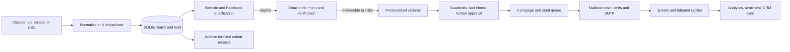

# odd-ecosys — Project Analysis and Developer Guide

**Prepared:** 6 October 2026  
**Purpose:** Give a developer a practical, code-based map of this repository: what it is, what screens and pipeline stages exist, how data moves, how to run it, and what needs attention before extending or operating it.

> This guide describes the checked-in source files. It separates implemented behavior from the broader architecture described by `plan.md` and `real.md`. Those two files currently have identical content and should be treated as design documentation, not proof that every proposed service or workflow is deployed.

**Updated source audit:** The current sending engine contains simulated success paths, falsely infers delivery after SMTP acceptance, and infers DKIM from SPF/DMARC. Bedrock is a stub, fact-check failure can pass, and CRM/AI usage reporting can report unsupported success or estimates as actual results. Treat feature descriptions below as a source map, not readiness evidence. [ORCHESTRATOR_GLM_5_3.md](ORCHESTRATOR_GLM_5_3.md) records 26 defects, 96 requirements, 24 implementation phases, and the tests/release gates needed to replace these paths.

## 1. Project at a glance

odd-ecosys is a local-first cold-email outreach operations dashboard and lead-processing backend. It combines:

- A browser-based, single-page CRM/control panel.
- A Node.js HTTP server and JSON API.
- A SQLite database for leads, batches, verification, copy, mailboxes, campaigns, sends, and events.
- A nine-stage lead/outreach workflow: discovery, persistence, website qualification, email verification, copy generation and review, mailbox/sending, A/B measurement, reply/event analytics, and CRM control.
- Optional integrations with a Google Maps scraper running in Docker, Reacher, Ollama, SMTP mailboxes, and Twenty CRM.

The codebase is a **single Node application**, not a Next.js project and not a collection of independently deployed services. The frontend uses native JavaScript ES modules and builds each screen into the page at runtime. The “nine phases” refer to pipeline capabilities, while the dashboard currently exposes nine UI views.

### Intended users and workflow

An operator collects or imports a bounded group of business leads, removes duplicates, checks whether their websites look live/outdated/parked, verifies their email addresses, prepares and reviews personalized copy, configures sending mailboxes and campaigns, queues/processes sends, and then monitors replies and performance. Batch IDs are the main way to scope work and follow a cohort through these steps.

## 2. What is in this repository

| Path | Responsibility |
|---|---|
| `index.html` | HTML shell, font loading, styles, loading state, and browser module entry point. |
| `server.js` | Node HTTP server, static files, API route dispatch, rate limiting, and pipeline module initialization. |
| `js/` | Frontend SPA router, API client, and one renderer/controller module per dashboard view. |
| `css/main.css` | Full dashboard styling and responsive behavior. |
| `pipeline/` | Backend business logic, database, batch handling, integrations, and CLI. |
| `config/` | JSON configuration for qualification, email verification, personalization, sending, and parked-domain signatures. |
| `data/` | Local SQLite database and sample CSV. The database is runtime state and should be treated as user data. |
| `plan.md`, `real.md` | Long-form architecture plan. These files are byte-identical in the inspected checkout. |
| `package.json`, `package-lock.json` | Node scripts and pinned/resolved dependencies. |
| `pipeline/Untitled-1.txt` | Large unrelated/exported HTML text artifact. It is not imported by the app or CLI. |

### Backend modules

| File | Main role |
|---|---|
| `pipeline/database.js` | Creates/opens SQLite, schema, indexes, compatibility migrations, aggregate DB stats. |
| `pipeline/batch-manager.js` | Create, start, close, list, and summarize cohorts. |
| `pipeline/lead-discovery.js` | Run scraper-based discovery or import CSV records, normalize/deduplicate, persist leads. |
| `pipeline/scraper.js` | Build scraper query files, invoke Docker scraper, parse its CSV output. |
| `pipeline/enricher.js` | Crawl business sites for email, Facebook URL, and phone details. |
| `pipeline/dedup.js` | Normalize URL domains and phone numbers and identify duplicate leads. |
| `pipeline/qualifier.js` | Check website/Facebook liveness and signals, assign a site status/score/confidence, support stale rechecks. |
| `pipeline/screenshot.js` | Screenshot/rendered-page helper. Source comments say screenshot capture is a placeholder unless Playwright is available. |
| `pipeline/email-verifier.js` | Syntax, MX, disposable/free/role/catch-all checks; optional Reacher integration; batch and single-email operations. |
| `pipeline/personalizer.js` | Generate variants, apply copy guardrails/fact checks, manage approval/edit/reject states. Ollama is used by default; the Bedrock function is currently a stub. |
| `pipeline/sending-engine.js` | Mailbox setup, DNS and SMTP checks, warm-up/health limits, queueing, sending, campaign and send stats. |
| `pipeline/ab-testing.js` | Assign variants, compute comparisons/timelines, promote a winner when configured criteria are met. |
| `pipeline/compliance.js` | Unsubscribe tokens/headers/footer, suppression list, pre-send checks. |
| `pipeline/reply-tracker.js` | Ingest replies, classify sentiment, record open/click events, materialize daily rollups. |
| `pipeline/crm-sync.js` | Optional Twenty CRM sync, domain blacklist, emergency sending kill switch/control-plane status. |
| `pipeline/archiver.js` | Move eligible terminal leads/sends to archive tables and compact SQLite. |
| `pipeline/csv-importer.js` | CSV column detection/mapping and template export helper. |
| `pipeline/seed.js` | Demo/sample database seeding helper. |
| `pipeline/cli.js` | Command-line entry point for a subset of pipeline operations. |

### Frontend modules

| File | Responsibility |
|---|---|
| `js/app.js` | View registry, sidebar/header shell, hash navigation, live status indicators. |
| `js/api.js` | Shared fetch client and typed-by-convention API groups (`Leads`, `Batches`, `Qualify`, `Verify`, etc.). |
| `js/utils.js` | Shared in-memory state, counters, relative time and number formatting. |
| `js/dashboard.js` | Funnel, activity, and active-batch overview. |
| `js/leads.js` | Search/filter/paginated lead table and lead detail actions. |
| `js/qualification.js` | Website qualification run, progress, result/distribution views, spot checks, and rechecks. |
| `js/verification.js` | Batch/single email verification, result filters, distribution, and re-verification. |
| `js/personalization.js` | Generate and inspect email variants, edit/approve/reject copy, view progress/stats. |
| `js/mailboxes.js` | Mailbox fleet setup, DNS/SMTP checks, test email, pause/activate/retire, health and warm-up. |
| `js/campaigns.js` | Campaign create/list, A/B analysis, queue sends, process queue, auto-promote. |
| `js/batches.js` | Cohort creation, status, qualification start, close, archive. |
| `js/analytics.js` | Funnel metrics, event timeline, sentiment, AI usage/cost, niche/geography metrics and CSV export. |
| `js/data.js` | Legacy/demo fixture values. Current dashboard renderers mostly call the live API and do not import this fixture file. |

## 3. Screens, routes, and user-visible behavior

There is one served page (`/`, `index.html`) and nine hash-addressed dashboard views. They are client-side views, not separate server routes. For example, `/#leads` opens the Leads view. Navigation is registered in `js/app.js`.

| View / hash | What the operator can do |
|---|---|
| Dashboard / `#dashboard` | See high-level pipeline funnel and activity, inspect open batches, create a batch, jump to batch management. It reads live funnel/batch APIs. |
| Leads / `#leads` | Search business/city/email, filter/paginate lead records, open a detail view, and re-qualify eligible leads. The backend list endpoint supports batch/status/search filters and pagination. |
| Qualification / `#qualification` | Choose a batch, start/cancel website checks, watch progress, view status distribution and per-lead evidence/reasons/confidence, requalify one lead, inspect low-confidence leads, and requeue stale checks. |
| Verification / `#verification` | Choose a batch, start/cancel verification, filter results, inspect syntax/MX/SMTP and email flags, reverify one result, see verification distribution, or use a one-off email check. |
| AI Copy / `#personalization` | Select a batch, generate personalization, watch progress, inspect A/B copy variants and guardrail/fact-check state, edit a draft, approve or reject it, and view stats. |
| Mailboxes / `#mailboxes` | View mailbox fleet/health, add SMTP mailbox details, run DNS checks and SMTP handshake, send a real test message, recalculate health, process warm-up transitions, pause/activate/retire/delete mailboxes. |
| Campaigns / `#campaigns` | Create/list campaigns, inspect campaign and A/B stats/timeline, queue campaign sends, process/cancel queue work, and request automatic winner promotion. |
| Batches / `#batches` | Create cohorts, inspect counts/status, start qualification, navigate to later stages, close a cohort, archive eligible records. |
| Analytics / `#analytics` | Review activity/funnel charts, reply sentiment, AI cost/token accounting, niche/geography results, and export metrics as CSV. |

The app shell also polls Ollama connectivity and funnel queue/approval counts every 15 seconds. A hash change or refresh rebuilds the selected view. `document.startViewTransition` is used when the browser supports it.

## 4. End-to-end data flow



1. **Discovery/import:** A cohort is created or selected. Scraper or CSV data is normalized; dedup checks domain/phone/place identity; enrichment attempts to find contact channels on the business site.
2. **Qualification:** Website and Facebook checks produce status, score, confidence, reasons, and timestamps. Qualifier state updates lead status. Configuration defines thresholds/signals and concurrency.
3. **Verification:** Discovered emails are stored in `lead_emails`; verifier records status and attributes. Reacher is optional; local checks are also implemented.
4. **Personalization:** Two variants are created from lead/site facts. Guardrails check size, spam terms, required merge fields and banned openers; fact-checking may use Ollama. Human review can edit/approve/reject.
5. **Sending:** Approved copy is attached to campaign/send rows, queued against active mailboxes, checked against suppression and mailbox/domain policy, scheduled, then sent through Nodemailer SMTP.
6. **Feedback/control:** Opens/clicks/replies become event rows. Replies may be classified by Ollama. Campaign analysis reports variants and trends; optional CRM sync pushes lead changes to Twenty. Archive moves old eligible records out of hot tables.

The pipeline is database-centered, but the current implementation is a set of imported Node modules sharing one SQLite file. The architecture plan's separate workers, Redis queue, n8n conductor, Warmbly deployment, and Twenty CRM deployment are proposed choices, not infrastructure included in this repository.

## 5. Runtime and development setup

### Requirements

- Node.js with support for ES modules and the native `better-sqlite3` package. No explicit minimum Node version is stated in the repository.
- npm (a `package-lock.json` is present).
- Optional, depending on which feature is used: Docker and the configured Google Maps scraper image; Reacher service; Ollama with configured model; reachable SMTP credentials; Twenty CRM API/token; Playwright for screenshot support.

### Start the app

From the project root:

```bash
npm install
npm start
```

Then open `http://localhost:3000`. `npm run dev` runs the same `node server.js` process; it is not a hot-reloading development server. Set `PORT` to change the HTTP port.

The DB is created/opened at `data/pipeline.db` when pipeline initialization first occurs. The server lazily imports backend modules and calls `initDb()`; it also tries to recover stuck qualification records. If initialization fails, API calls return a 503-style initialization error and the cause is logged. The root page is static and can load before first API use.

### Package scripts

| Script | Actual command |
|---|---|
| `npm start` / `npm run dev` | `node server.js` |
| `npm run pipeline:discover` | `node pipeline/cli.js discover` |
| `npm run pipeline:import` | `node pipeline/cli.js import` |
| `npm run pipeline:seed` | `node pipeline/cli.js seed` |
| `npm run pipeline:batches` | `node pipeline/cli.js batch-status` |
| `npm run pipeline:stats` | `node pipeline/cli.js stats` |
| `npm run pipeline:template` | `node pipeline/cli.js template` |
| `npm run pipeline:help` | `node pipeline/cli.js help` |

**CLI mismatch to fix:** `pipeline/cli.js` currently implements only `discover`, `qualify`, `verify`, `personalize`, `queue-sends`, `process-sends`, `reply`, `suppress`, `archive-batch`, `crm-sync`, `kill-switch`, and `stats`. It imports a CSV helper but has no `import`, `seed`, `batch-status`, or `template` switch cases, despite package scripts advertising them and help text mentioning import. Those script aliases therefore do not perform their advertised operations yet. The CLI help also does not list every implemented command.

**CLI startup defect:** It imports `runPersonalizationBatch`, while `personalizer.js` exports `personalizeBatch`; this missing named export can prevent all CLI commands from starting. `seed.js` exists but is not imported by the CLI. Resolve the import and command dispatch before relying on these commands.

### CLI commands implemented in `pipeline/cli.js`

```bash
node pipeline/cli.js discover --niche "dentists" --geo "Austin TX"
node pipeline/cli.js qualify --batch-id 1
node pipeline/cli.js verify --batch-id 1
node pipeline/cli.js verify --email person@example.com
node pipeline/cli.js personalize --batch-id 1
node pipeline/cli.js queue-sends --campaign-id 1 --limit 50
node pipeline/cli.js process-sends --limit 50
node pipeline/cli.js reply --from "person@example.com" --body "Interested"
node pipeline/cli.js suppress --email "person@example.com"
node pipeline/cli.js archive-batch --batch-id 1
node pipeline/cli.js crm-sync --lead-id 1
node pipeline/cli.js kill-switch
node pipeline/cli.js stats
```

The CLI initializes the database before processing and closes it in `finally`. **Sending and kill-switch commands have real side effects** when configured; do not use against production data/mailboxes casually.

## 6. Technology and design specifications

### Stack

- Node.js, native `http`, ECMAScript modules (`"type": "module"`).
- Browser-native ES modules, HTML, CSS, no frontend framework or bundler.
- SQLite via `better-sqlite3`, configured with WAL, `synchronous=NORMAL`, foreign keys, and 5-second busy timeout.
- `cheerio` for HTML parsing; `csv-parse` and `csv-stringify` for CSV; `nodemailer` for SMTP; `@reacherhq/api` and `deep-email-validator` for verification support.
- No test runner or test script is configured in `package.json`.

### UI style and behavior

`index.html` uses Plus Jakarta Sans and JetBrains Mono from Google Fonts. `css/main.css` styles a dark glass/ambient dashboard with responsive cards, tables, badges and overlays. Browser module imports are relative (`./view.js`). The frontend API wrapper returns caller-provided fallback values after fetch errors, so screens may render empty/default states while the server logs warnings rather than crashing.

### SQLite model

The schema is created and migrated in `pipeline/database.js`. The main entities and purposes are:

| Table | Purpose / notable fields |
|---|---|
| `batches` | Cohort name, phase, open/closed status, lead count, opened/closed timestamps. |
| `leads` | Business identity/contact/location, website/Facebook, source, status, site score/status/reasons/confidence, qualification timestamps, normalized dedup keys and optional screenshot path. |
| `lead_emails` | One or more emails per lead, source, verification state, catch-all/role/disposable/free flags, MX/SMTP details and verifier JSON. |
| `suppression_list` | Global blocked email address, reason, timestamp. |
| `mailboxes` | SMTP connection fields, domain/provider, warm-up state, daily limit, health/active state, DNS check results. |
| `domains` | Domain SPF/DKIM/DMARC and blacklist status. |
| `personalizations` | Subject/body variant, generated text, model, guardrail/fact-check results, approval state. |
| `campaigns` | Name, sequence step, template reference, status, batch IDs, creation time. |
| `sends` | Lead/mailbox/campaign/copy references, variant, scheduled/sent times, send status and error. |
| `events` | Send/lead event type, timestamp and JSON metadata for opens, clicks, replies, etc. |
| `leads_archive`, `sends_archive` | Reduced historical copies used by batch archiving. |

Indexes exist for lead status/batch/dedup and event send/type/lead lookups. `runMigrations()` checks columns via `PRAGMA table_info` and adds newer columns to existing local DB files. The schema has no explicit user/account/tenant tables.

### Lead and send status concepts

Lead states used in the DB/stats include `discovered`, `checking`, `enriching`, `site_checked`, `verified`, `queued`, `sent`, `replied`, `won`, and `disqualified`; other transient/approval states may be used by specific modules. Send records move through scheduled/queued/sending/sent/error-like states depending on the sending path. Check actual transition logic in `qualifier.js`, `email-verifier.js`, `personalizer.js`, and `sending-engine.js` before adding a new status. The architecture proposal contains fuller state diagrams, but code is authoritative for current behavior.

### Important configuration defaults

| Config | Current notable values |
|---|---|
| `config/qualification-scoring.json` | Outdated threshold 40, modern threshold 70; weighted website signals; fetch timeout 10 seconds; concurrency 5; freshness 60 days; stuck-check threshold 15 minutes. |
| `config/verification-rules.json` | SMTP timeout 10 seconds; concurrency 3; 2-second same-domain delay; 500 ms email delay; suppress disposable/invalid syntax/no-MX; classify catch-all as risky; do not automatically suppress role accounts. |
| `config/personalization.json` | Ollama at localhost:11434, llama3.1, enabled; Bedrock disabled by default; 40–130 word email body, subject max 60 chars; variants A/B; first 20 per niche require approval before auto-approval policy. |
| `config/sending-engine.json` | 35-day warm-up ramp; max 50 sends/mailbox/day and 150/domain/day; minimum health score 40; auto-pause at configured bounce/complaint thresholds; send window 08:00–17:00 weekdays America/Chicago; randomized delay 30–120 seconds. A/B defaults: sample size 200, confidence threshold .95, 10% challenger, minimum 30 sends, primary metric reply. |
| `config/parking-signatures.json` | Text phrases, provider fingerprints and HTML markers used to detect parked domains. |

These are application defaults, not a substitute for validating actual SMTP, privacy, compliance, deliverability, or AI-provider behavior in the operating environment.

## 7. HTTP API reference

The API is served from the same origin as the dashboard. The endpoint handlers are in `server.js`; the UI wrappers are in `js/api.js`. Query parameters and request JSON are consumed by handlers/modules; consult those implementations for exact fields and response shapes.

### Core data, batches, metrics, and compliance

| Method and path | Purpose |
|---|---|
| `GET /api/batches` | List batches. |
| `POST /api/batches` | Create a batch. |
| `GET /api/batches/:id` | Batch details/stats. |
| `POST /api/batches/:id/close` | Advertised by the client wrapper, but no matching server handler was found in this source snapshot. |
| `POST /api/batches/:id/archive` | Archive eligible batch records. |
| `GET /api/leads` | Filter/search/page leads. |
| `GET /api/leads/:id` | Lead detail plus related emails/events. |
| `GET /api/leads/site-status-distribution` | Qualification status counts. |
| `GET /api/stats/discovery`, `/api/stats/funnel`, `/api/stats/analytics`, `/api/stats/archive` | Pipeline, funnel, analytics, archive summaries. |
| `GET /api/suppression`, `POST /api/suppression` | Inspect/add suppressed emails. |
| `GET /api/events` | Query recorded events. |
| `GET /api/unsubscribe` or `POST /api/unsubscribe` | Process signed unsubscribe token and suppress address. |

### Qualification

| Method and path | Purpose |
|---|---|
| `POST /api/qualify/batch/:id` | Start qualification for a batch. |
| `POST /api/qualify/batch/:id/cancel` | Cancel qualification. The current UI wrapper instead calls `/api/qualify/cancel`, which has no matching handler. |
| `GET /api/qualify/status` | Current progress. |
| `GET /api/qualify/results/:batchId` | Batch results. |
| `POST /api/qualify/lead/:id` | Requalify one lead. |
| `POST /api/qualify/recheck-stale`, `GET /api/qualify/stale-count` | Requeue/count stale checks. |
| `GET /api/qualify/spot-check/:batchId` | Low-confidence sample. |

### Email verification

| Method and path | Purpose |
|---|---|
| `POST /api/verify/batch/:id` | Start batch verification. |
| `POST /api/verify/batch/:id/cancel` | Cancel verification. The current UI wrapper instead calls `/api/verify/cancel`, which has no matching handler. |
| `GET /api/verify/status`, `GET /api/verify/results/:batchId`, `GET /api/verify/distribution` | Progress, results, aggregate states. |
| `POST /api/verify/email/:id` | Reverify a stored email row. |
| `POST /api/verify/single` | Verify an arbitrary email. |
| `GET /api/verify/reacher-status` | Reacher integration status. |

### Personalization

| Method and path | Purpose |
|---|---|
| `POST /api/personalize/batch/:id`, `POST /api/personalize/cancel` | Start/cancel generation. |
| `GET /api/personalize/status`, `/list`, `/awaiting`, `/stats` | Progress, drafts, approval queue, stats. |
| `POST /api/personalize/approve/:id`, `POST /api/personalize/reject/:id` | Human review actions. |
| `PATCH /api/personalize/:id` | Edit a personalization. |
| `GET /api/personalize/ollama-test` | Check Ollama connection. |

### Mailboxes, sending, and A/B testing

| Method and path | Purpose |
|---|---|
| `GET/POST /api/sending/mailboxes` | List/add mailboxes. |
| `PATCH/DELETE /api/sending/mailboxes/:id` | Update/delete mailbox. |
| `POST /api/sending/mailboxes/:id/verify-dns`, `.../test-smtp`, `.../send-test` | DNS inspection, SMTP handshake, real test email. |
| `POST /api/sending/mailboxes/:id/pause`, `.../activate`, `.../retire` | Fleet controls. |
| `POST /api/sending/health-recompute`, `/warmup-check`, `/threshold-check` | Refresh health/warm-up/threshold states. |
| `GET/POST /api/sending/campaigns` | List/create campaigns. |
| `GET /api/sending/campaigns/:id/variants`, `.../timeline` | A/B stats and campaign timeline. |
| `POST /api/sending/queue/:campaignId`, `GET /api/sending/queue/:campaignId` | Queue/view sends. |
| `POST /api/sending/process`, `/cancel`; `GET /api/sending/status`, `/stats` | Send queue operations and status. |
| `POST /api/sending/ab/auto-promote`, `GET /api/sending/ab/assign/:campaignId` | Winner promotion and variant assignment. |

### Replies and CRM control

| Method and path | Purpose |
|---|---|
| `POST /api/replies/ingest`, `GET /api/replies/sentiment-breakdown` | Record/classify inbound reply; summarize sentiment. |
| `GET /api/track/open/:sendId`, `GET /api/track/click/:sendId` | Tracking pixel/redirect event recording. |
| `POST /api/crm/sync/:leadId`, `GET /api/crm/status` | Sync one lead and read control plane status. |
| `POST /api/crm/kill-switch`, `POST /api/crm/blacklist-domain` | Stop sends or blacklist a domain. |

## 8. Integrations and environment variables

The app has no checked-in `.env.example`. Defaults are embedded in modules/config; environment variables override some external connection settings:

| Variable | Used for | Default behavior |
|---|---|---|
| `PORT` | HTTP listener | `3000`. |
| `OLLAMA_HOST`, `OLLAMA_MODEL` | Reply sentiment classifier | localhost Ollama, model `llama3.1`. Personalization also has its own JSON base URL/model config. |
| `REACHER_API_URL`, `REACHER_TIMEOUT_MS` | Reacher email verifier | localhost:8080 and 35 seconds. |
| `TWENTY_API_URL`, `TWENTY_API_TOKEN` | Twenty CRM sync | localhost:3001 GraphQL; empty token unless configured. |
| `APP_URL` | Unsubscribe links | localhost fallback. |
| `COMPLIANCE_SECRET` | Signed unsubscribe tokens | **Insecure built-in development fallback exists. Replace with a secret in production.** |
| `COMPANY_PHYSICAL_ADDRESS` | Compliance footer | A sample Austin address is embedded as a fallback; configure a real, valid business address before sending. |

SMTP credentials are stored in the `mailboxes` table (`smtp_user`, `smtp_pass`, related host/port/security fields). They are collected by the mailbox form and persisted through the API. Protect the SQLite file and backups accordingly.

Optional integration behavior:

- **Google Maps scraper:** `scraper.js` builds a query file and invokes Docker; this path depends on local Docker and the scraper image/tool being available.
- **Ollama:** Local generation/classification. The UI shows online/offline, but generation requires Ollama and the configured model.
- **Bedrock:** Personalization config names a Claude model, but `enabled` is `false` by default and `callBedrock()` only returns null. This is not a working cloud adapter yet.
- **Reacher:** Optional verifier service; local verification code also exists. API reports Reacher state.
- **SMTP:** Nodemailer sends using configured mailbox credentials. Without credentials, test/queue paths currently simulate successful sends; real SMTP acceptance also inserts a delivery event without separate delivery proof. These are release-blocking defects.
- **Twenty CRM:** Token is empty by default; the sync function uses an unverified generic mutation and can return synchronized status from a local fallback. The architecture plan does not ship the Twenty server/container. Real synchronization needs schema/error/result validation.
- **Playwright:** Screenshot helper detects availability; source comments identify screenshot support as placeholder when it is absent.

## 9. Security, privacy, compliance, and operational limits

This app can hold personal/contact data and send external email. Before exposing it beyond a trusted local development machine, review at least these code-level facts:

1. **No authentication/authorization layer is visible in the HTTP server.** Dashboard/API actions are not protected by a login or role check in the inspected source.
2. **CORS allows `*`** on JSON and static responses. The server is intended for local operation; public hosting needs origin restrictions and access control.
3. **The app has a hardcoded unsubscribe secret fallback** and sample physical address fallback. Set `COMPLIANCE_SECRET`, `COMPANY_PHYSICAL_ADDRESS`, and `APP_URL` before real operation.
4. **Mailbox passwords are stored in SQLite** by the current schema. Restrict filesystem access, backup access, and exports; design encryption/secret-manager handling before production deployment.
5. **Request parsing has no explicit body-size limit** in `parseBody()`. The rate limiter is a simple in-memory limit applied to selected qualification POST endpoints, not a general API defense.
6. **Static file serving should be security-reviewed.** `server.js` joins a URL path to the project directory; verify path traversal handling before exposing the server publicly.
7. **Legal/compliance requirements depend on jurisdiction and recipient type.** The plan contains a compliance checklist and specifically says to validate it with appropriate counsel; treat it as design guidance, not legal advice.
8. **Email verification can interact with external mail servers** and may be blocked or yield uncertain results. SMTP probing is not equivalent to guaranteed deliverability.
9. **Do not mistake analytics opens for reliable engagement.** Email client privacy protections can distort opens; replies and downstream outcomes need to be interpreted carefully.
10. **Database files are mutable production state.** Back up `data/pipeline.db` and understand archive/vacuum behavior before operating on real cohorts.

The architecture plan describes suppression, truthful copy, unsubscribe footers, warm-up, send caps, and auto-pause as required protections. Check live implementation and configuration before sending: design intent alone does not demonstrate correct operation in a real environment.

## 10. Gaps, inconsistencies, and recommended first fixes

These are findings from source inspection, not runtime test results.

### Documentation and repo setup

- There is no root `README.md`; the two available long-form docs, `real.md` and `plan.md`, are identical architecture proposals. Add a project README or use this analysis as the starting point.
- The docs propose an ecosystem with n8n, Redis/worker queues, Warmbly, Twenty CRM, and other tools, while the implementation currently lives in one Node process and SQLite. Clearly mark planned vs live capabilities in future docs.
- `pipeline/Untitled-1.txt` appears unrelated to application runtime; determine its provenance before deleting or repurposing it.

### Developer commands

- Package scripts for import, seed, batch-status and template don't match CLI switch cases. Add cases and argument validation, or remove/rename those scripts.
- `index.html` says to open port 3000 and run `npm start`; this is broadly consistent with `server.js`, but `PORT` can change the actual URL.
- There is no test or lint script in `package.json`. Build tests around DB migrations, state transitions, compliance gates, and send queue logic before changing them.

### Integration and code paths to verify before production

- Fix the qualification and verification cancellation route mismatch: UI wrappers call `POST /api/qualify/cancel` and `POST /api/verify/cancel`, but `server.js` only handles `POST /api/qualify/batch/:id/cancel` and `POST /api/verify/batch/:id/cancel`. The UI cancel actions therefore currently receive a not-found response.
- The database schema has no obvious `ab_tests` table in `database.js`; A/B logic may derive assignments/statistics from campaigns, sends and events. Confirm intended persistence and migration behavior before changing A/B analysis.
- Screenshot capture is explicitly described as a placeholder unless Playwright is installed. Do not assume all qualification runs have screenshots.
- The qualification config lists weighted signals and thresholds, but verify these against current scoring logic when tuning results.
- No authentication, tenant isolation or formal secret-management layer appears in this local-first app.

### Suggested order for a new contributor

1. Read `server.js`, `pipeline/database.js`, `pipeline/batch-manager.js`, then `pipeline/cli.js` to understand startup, persistence and commands.
2. Trace a lead through `pipeline/lead-discovery.js` → `qualifier.js` → `email-verifier.js` → `personalizer.js` → `sending-engine.js` → `reply-tracker.js`.
3. Use the matching UI module under `js/` to understand API calls and operator flow.
4. Check relevant config JSON before changing scores, safety gates, generation, or send limits.
5. Add a test strategy and DB migration when a change alters schema/state behavior. Avoid using a real mailbox during development.
6. Resolve the CLI script mismatch and document integrations/secrets before attempting a deployment.

## 11. Useful source map for common changes

| If you want to change… | Start here |
|---|---|
| Navigation, top bar, Ollama/server status | `js/app.js` |
| A dashboard screen | matching `js/<view>.js`, then `css/main.css` |
| API request/response behavior | `server.js`, `js/api.js` |
| Lead fields or DB schema | `pipeline/database.js` plus migrations and dependent modules |
| Batch lifecycle | `pipeline/batch-manager.js`, `pipeline/archiver.js`, `js/batches.js` |
| Lead collection and CSV mapping | `pipeline/lead-discovery.js`, `pipeline/scraper.js`, `pipeline/enricher.js`, `pipeline/csv-importer.js` |
| Website scoring | `pipeline/qualifier.js`, `config/qualification-scoring.json`, `config/parking-signatures.json` |
| Email deliverability checks | `pipeline/email-verifier.js`, `config/verification-rules.json` |
| AI copy and review | `pipeline/personalizer.js`, `config/personalization.json`, `js/personalization.js` |
| Mailbox safety/sending | `pipeline/sending-engine.js`, `config/sending-engine.json`, `pipeline/compliance.js` |
| A/B assignment and winner logic | `pipeline/ab-testing.js`, campaign/send/event schema, `js/campaigns.js` |
| Replies and reporting | `pipeline/reply-tracker.js`, server stats routes, `js/analytics.js` |
| CRM sync and emergency stop | `pipeline/crm-sync.js`, `/api/crm/*` routes |

## 12. Architecture-plan coverage

`plan.md` / `real.md` provide additional design-level detail on phases, tool choices, proposed deployment, security, monitoring, data lifecycle, state machines, mailbox health, prompts, and a jurisdiction-aware compliance checklist. Refer to those sections for design context, then confirm every desired behavior in code before relying on it.

The plan describes:

- Phase 0 compliance and deliverability setup.
- Phase 1 Maps/business discovery and website enrichment.
- Phase 2 SQLite storage, with a future Postgres migration path.
- Phase 3 website/Facebook liveness and staleness analysis.
- Phase 4 email verification.
- Phase 5 AI-personalized copy using local and cloud models.
- Phase 6 mailbox rotation, warm-up, scheduling, and limits.
- Phase 7 A/B tests.
- Phase 8 tracking, reply sentiment, reporting/data warehouse concepts.
- Phase 9 CRM control plane and manual kill switch.
- Batch archiving, state machines, deployment sketch, monitoring, and a staged MVP-to-maturity roadmap.

## 13. Accuracy notes

- This file was created from source inspection on 6 October 2026; no application build, API exercise, or automated test suite was run for this documentation task.
- The local `data/pipeline.db` was not inspected for lead or mailbox contents. It may contain operational records and secrets.
- Some route/API observations are based on static code paths and should be confirmed before relying on the endpoint from production.
- If code changes, update this document and the relevant config/API/schema sections together.

