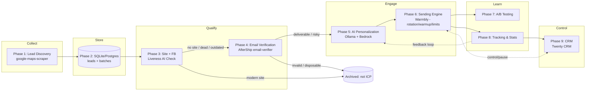
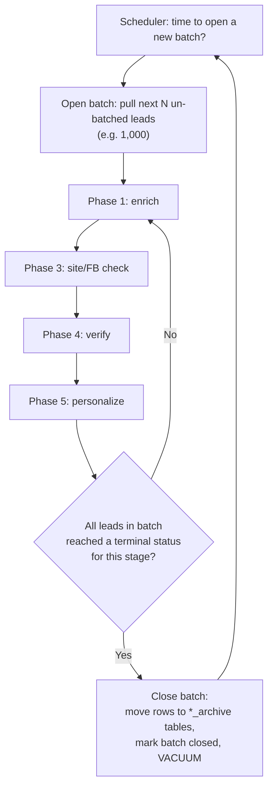
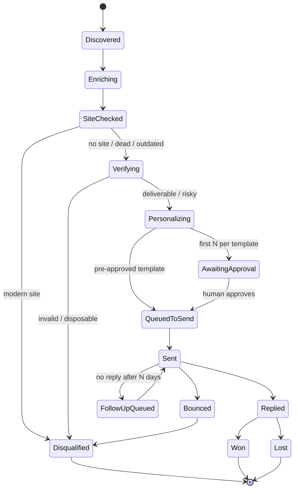
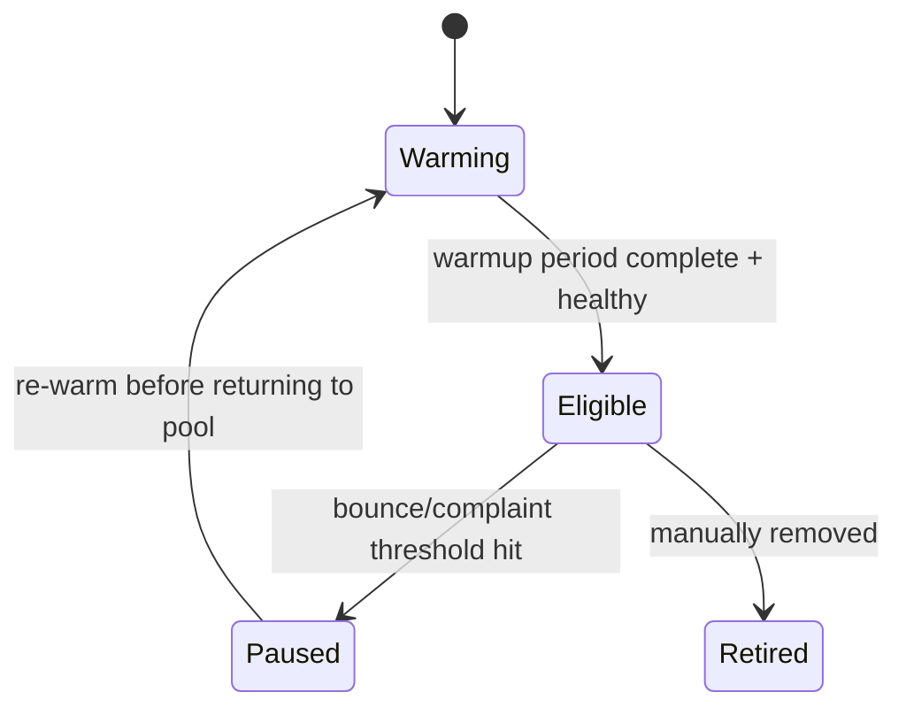

# Cold Email Outreach Ecosystem — Full Pipeline Architecture

**A modular, batch-driven, AI-assisted B2B outreach system built on open-source tools, SQLite, Ollama (local) + AWS Bedrock (cloud), with a CRM control plane.**

> Assumptions made while designing this (change anything that doesn't fit): small-to-mid technical team, self-hosted infra (VPS/cloud), starting volume in the low thousands of leads/week scaling up, B2B targets (business emails, not consumers), primary goal = book meetings/sell a service to businesses with no site / an outdated site.

---

## Table of Contents

0. [Executive Overview](#0-executive-overview)
1. [Design Principles](#1-design-principles)
2. [Compliance & Deliverability Foundation (Phase 0)](#2-compliance--deliverability-foundation-phase-0)
3. [Architecture at a Glance](#3-architecture-at-a-glance)
4. [Tool Stack Matrix](#4-tool-stack-matrix)
5. [Phase 1 — Lead Discovery (Business Email + Facebook Page)](#5-phase-1--lead-discovery-business-email--facebook-page)
6. [Phase 2 — Lightweight SQL Storage](#6-phase-2--lightweight-sql-storage)
7. [Phase 3 — Website/Facebook Liveness & Staleness AI Check](#7-phase-3--websitefacebook-liveness--staleness-ai-check)
8. [Phase 4 — Email Verification (AfterShip email-verifier)](#8-phase-4--email-verification-aftership-email-verifier)
9. [Phase 5 — AI Personalization & Copywriting (Ollama + Bedrock)](#9-phase-5--ai-personalization--copywriting-ollama--bedrock)
10. [Phase 6 — Sending Engine (Rotation, Warmup, Limits, Scheduling)](#10-phase-6--sending-engine-rotation-warmup-limits-scheduling)
11. [Phase 7 — A/B Testing Framework](#11-phase-7--ab-testing-framework)
12. [Phase 8 — Tracking, Stats & Data Warehouse](#12-phase-8--tracking-stats--data-warehouse)
13. [Phase 9 — CRM Control Plane ("Beautiful CRM")](#13-phase-9--crm-control-plane-beautiful-crm)
14. [Batch/Cohort Engine — Memory & Performance Strategy](#14-batchcohort-engine--memory--performance-strategy)
15. [AI Model Routing — Ollama vs AWS Bedrock](#15-ai-model-routing--ollama-vs-aws-bedrock)
16. [Data Model — Full SQL Schema](#16-data-model--full-sql-schema)
17. [State Machines](#17-state-machines)
18. [Mailbox Rotation & Health Scoring](#18-mailbox-rotation--health-scoring)
19. [Deployment Sketch (docker-compose)](#19-deployment-sketch-docker-compose)
20. [Security, Secrets & Data Retention](#20-security-secrets--data-retention)
21. [Monitoring & Alerting](#21-monitoring--alerting)
22. [Build Roadmap](#22-build-roadmap)
23. [Appendix A — Tool/GitHub Reference List](#23-appendix-a--toolgithub-reference-list)
24. [Appendix B — Prompt Skeletons](#24-appendix-b--prompt-skeletons)
25. [Appendix C — Compliance Checklist](#25-appendix-c--compliance-checklist)
26. [Appendix D — Glossary](#26-appendix-d--glossary)

---

## 0. Executive Overview

This is a **9-phase pipeline** plus a **batch engine** and a **CRM control plane**, wired together by a workflow orchestrator (n8n) and a queue/worker layer for the heavy lifting (scraping, AI calls, verification). Every phase is decoupled — each writes its output to a shared SQL database and the next phase picks up from there. Nothing is a single monolith; you can swap any single piece (scraper, CRM, sending engine) without rebuilding the rest.

The core idea you asked for — **"collect a lot, process a batch, close it, move on"** — is implemented as a **Batch/Cohort Engine** (Section 14): leads move through the pipeline in bounded cohorts (e.g. 500–2,000 at a time), and once a cohort is fully processed it's archived out of the "hot" working tables. This is what keeps SQLite fast and keeps AI token costs predictable instead of ballooning as your lead list grows into the hundreds of thousands.

Two engines you didn't name but that make the whole thing production-grade have been added: a **warmup + mailbox rotation + sending-limit engine** (Warmbly, open-source) and a **CRM** (Twenty CRM, open-source) as the human-facing dashboard. Both are optional to swap out, but they save you from building deliverability infrastructure from scratch — that part is genuinely hard to get right and is where most cold-email operations die (blacklisted domains, not booked meetings).

---

## 1. Design Principles

1. **Decoupled phases, shared database.** Each phase is its own service/script/workflow. It reads leads in a given `status`, does its job, writes the result + new `status`. No phase calls another phase directly — they communicate only through the database (or a queue). This means any phase can crash, restart, or be swapped without touching the rest.
2. **Batch everything.** Never run a phase against "all leads ever collected." Always run against `batch_id = X, status = Y, limit = N`. This bounds memory, bounds AI spend, and bounds blast radius if something goes wrong (e.g. a bad prompt generating garbage — it only affects one batch, not your whole list).
3. **Cheap-first AI routing.** Every AI decision starts on local Ollama. Only ambiguous, high-value, or "money" decisions (final subject line, final copy, vision-based site scoring) escalate to Bedrock. This keeps AI cost near-zero for the 80% of leads that get filtered out anyway.
4. **Reputation is the real product.** Sending limits, warmup, and rotation aren't optional add-ons — they're the difference between emails landing in inboxes vs. spam folders vs. your domain being blacklisted entirely. This pipeline treats deliverability infrastructure as **Phase 0**, before a single email is written.
5. **Everything is measured.** Every send, open, click, bounce, and reply is an event row. You cannot improve personalization or subject lines without a stats layer feeding back into what you send next — this is closed-loop, not fire-and-forget.
6. **Suppression is global and permanent.** One unsubscribe/complaint = that email never gets contacted again, regardless of batch, campaign, or CRM view. This table is checked before every single send, no exceptions.
7. **A human can always see and stop it.** The CRM is not cosmetic — it's the kill-switch and the visibility layer. Nothing should require SSH-ing into a server to see what's happening or to pause a campaign.

---

## 2. Compliance & Deliverability Foundation (Phase 0)

Before Phase 1 even runs, set this up — it's infrastructure the whole pipeline depends on. I'm not a lawyer, and rules vary by where your leads and business are located (CAN-SPAM in the US, GDPR/PECR in the EU/UK, CASL in Canada) — treat the checklist in **Appendix C** as a starting point, not legal advice, and have someone verify it for your specific jurisdictions.

**Domain & DNS setup (per sending domain):**
- SPF record authorizing your sending sources
- DKIM signing enabled on every mailbox/relay
- DMARC policy (start at `p=none` for monitoring, move to `p=quarantine` once clean)
- Dedicated **sub-domains for cold outreach** (e.g. `outreach1.yourcompany.com`) instead of your primary corporate domain — this isolates reputation risk. If a sub-domain gets flagged, your main business domain (and inbox) is unaffected.
- MTA-STS / TLS-RPT if using your own SMTP server (mox and Postal both support this out of the box)

**2024+ bulk sender requirements (Google/Yahoo):** if you send meaningful volume, you need one-click unsubscribe (`List-Unsubscribe` + `List-Unsubscribe-Post` headers, RFC 8058), authenticated SPF+DKIM with DMARC alignment, and a spam-complaint rate kept under roughly 0.3%. Build this in from day one rather than retrofitting it.

**Non-negotiable compliance features baked into the schema (Section 16):**
- Global suppression list, checked pre-send
- Physical mailing address in every email footer
- Honest "From" name/domain, honest subject line (no deceptive claims in the personalization AI's output — enforced by a validation pass in Phase 5)
- Unsubscribe processed automatically (webhook → suppression table) within the required window

---

## 3. Architecture at a Glance



Orchestration layer running underneath all of this: **n8n** (self-hosted, open-source workflow automation) triggers each phase on a schedule or via webhook, and a **Redis + worker queue** (Celery/RQ/BullMQ) handles the actual heavy lifting (headless browser scraping, AI calls, SMTP verification) so n8n stays the "conductor," not the thing doing the work.

---

## 4. Tool Stack Matrix

| Phase | Purpose | Recommended tool | Type | Why |
|---|---|---|---|---|
| 0 | DNS/deliverability checks | `mxtoolbox`, Google Postmaster Tools | Free web tools | Verify SPF/DKIM/DMARC + blacklist status before sending anything |
| 1 | Business discovery | [`gosom/google-maps-scraper`](https://github.com/gosom/google-maps-scraper) | Go, CLI/Web UI/REST | Actively maintained, extracts name/address/phone/website/rating/email, self-hostable |
| 1 | Website → email/FB enrichment | Custom Python (`httpx` + `BeautifulSoup`) | Script | Visits the business's own site to pull email + Facebook link from footer/contact page — avoids scraping Facebook directly |
| 2 | Storage | SQLite (WAL mode) → Postgres later | Embedded/DB | Zero-ops to start, clean migration path when volume grows |
| 3 | Tech/staleness fingerprinting | [`projectdiscovery/wappalyzergo`](https://github.com/projectdiscovery/wappalyzergo) | Go lib | Fast tech-stack detection to flag outdated CMS/frameworks |
| 3 | Visual staleness scoring | Playwright (screenshot) + Bedrock vision call | Script + AI | A cheap heuristic can't "see" a bad design — a vision model can |
| 4 | Email verification | [`AfterShip/email-verifier`](https://github.com/AfterShip/email-verifier) | Go lib | Syntax + MX + SMTP reachability + disposable/role/catch-all detection, no email actually sent |
| 5 | Local AI drafting | Ollama (Llama 3.x / Mistral, self-hosted) | Local LLM runtime | Free, private, fast for bulk first-draft + classification |
| 5 | Cloud AI polishing | AWS Bedrock (Claude models) | Managed API | Stronger reasoning for the final "money" copy: subject lines & hooks |
| 6 | Sending, warmup, rotation | [`warmbly/warmbly`](https://github.com/warmbly/warmbly) | Self-hosted platform (Apache-2.0) | Purpose-built: mailbox connections, warmup pool, spintax/merge fields, tracking, webhooks, basic CRM |
| 6 (alt.) | Raw SMTP relay | [`postalserver/postal`](https://github.com/postalserver/postal) or [`mjl-/mox`](https://github.com/mjl-/mox) | Self-hosted MTA | Use instead of Warmbly if you want full control over your own SMTP stack rather than OAuth'd Gmail/Outlook mailboxes |
| 7 | A/B testing | Built into Warmbly (spintax/variables) + custom stats table | Native + SQL | Keep raw event data in your own DB regardless of sending tool, for independent analysis |
| 8 | Tracking/events | Warmbly webhooks → your DB | Webhooks | Opens, clicks, replies, bounces, complaints as first-class rows |
| 9 | CRM | [`twentyhq/twenty`](https://github.com/twentyhq/twenty) | Self-hosted (AGPL-3.0) | Modern, Notion/Linear-style UI, GraphQL+REST API, fully custom objects — genuinely "beautiful" |
| Orchestration | Workflow automation | [n8n](https://github.com/n8n-io/n8n) | Self-hosted | Visual workflows, cron/webhook triggers, huge integration library |
| Queue/workers | Parallel processing | Redis + Celery/RQ/BullMQ | Infra | Keeps scraping/AI/verification off the orchestrator's critical path |
| Scheduling/booking (optional) | Meeting booking from replies | [Cal.com](https://github.com/calcom/cal.com) | Self-hosted | If your outreach goal is booked calls, not just replies |

---

## 5. Phase 1 — Lead Discovery (Business Email + Facebook Page)

**Goal:** collect business name, address, phone, website (if any), business email, and Facebook page URL for a target niche + geography.

**Step 1 — Bulk discovery.** Run `google-maps-scraper` against a query list (`"dentists in Austin TX"`, `"plumbers in Leeds UK"`, etc.). It returns, per listing: name, category, address, phone, rating, review count, website URL (if listed on the profile), and lat/long. This is your **raw candidate list**.

**Step 2 — Website enrichment pass.** For every candidate that has a website URL, a lightweight crawler (`httpx` + `BeautifulSoup`, or Playwright for JS-heavy sites) visits the homepage + `/contact` + `/about` pages and extracts:
- Any `mailto:` email addresses
- Any link containing `facebook.com` (this is your **Facebook Page URL** — required field)
- Phone numbers (as a fallback identity signal)

**On Facebook specifically — do this, not that:**
- ✅ **Do:** pull the Facebook Page link from the business's own website or from the Maps listing metadata (both are the business publicly advertising the link itself).
- ✅ **Do:** if you need actual Page content (About text, post recency) beyond just the URL, use Meta's official **Graph API "Page Public Content Access"** feature (requires Meta app review, but is the compliant, ToS-safe path).
- ❌ **Don't:** log in and scrape facebook.com pages directly with a bot/headless browser. It violates Meta's Terms of Service, Meta actively pursues legal action against scrapers, and it puts your entire operation's IPs/accounts at risk for a single data field. Not worth it — the "must have a Facebook page" requirement is satisfied just as well by capturing the *link*, which the enrichment crawler above already does for you legitimately.

**Step 3 — Fallback discovery for "no website" businesses.** If the Maps listing has no website field, that business is *already* a strong "no site" lead for Phase 3 — mark it `website_url = NULL` and let it flow straight into the staleness-check phase, which will immediately classify it as `NO_SITE` and pass it to verification. For these, the Facebook Page becomes your **primary** enrichment source (via the Maps listing's social links, if present, or a manual/Graph-API lookup) since there's no company site to pull an email from — you may end up relying on the phone number + a generic `info@` guess pattern (`info@businessname.com` if a domain exists for booking/social only) or simply routing these to a "Facebook-only, no email available" bucket that a human or a different channel handles, rather than fabricating an email.

**Step 4 — Dedup on ingest.** Before writing to the database, dedupe by normalized domain + normalized phone, so the same business scraped from two different search queries doesn't create two lead rows.

**Output of Phase 1:** rows in `leads` with `status = 'discovered'`, batch-tagged.

---

## 6. Phase 2 — Lightweight SQL Storage

**SQLite** is the right call here for "lightweight" — zero server process, single file, trivial backups (`cp leads.db backup.db`), and with **WAL mode** enabled it handles concurrent reads fine while one writer process ingests new batches.

```sql
PRAGMA journal_mode = WAL;
PRAGMA synchronous = NORMAL;
PRAGMA foreign_keys = ON;
```

**When to graduate to Postgres:** once you have multiple worker processes writing concurrently at real volume (rule of thumb: once you're processing >5–10k leads/week with several parallel workers), SQLite's single-writer model becomes a bottleneck. Because the schema (Section 16) uses plain SQL with no SQLite-specific syntax beyond `PRAGMA`, migrating is a schema export + `pgloader` job, not a rewrite. Keep this in mind from day one so the migration is boring, not a rebuild.

Every table has a `batch_id` and a `status` column — this is what makes the batch engine (Section 14) work.

---

## 7. Phase 3 — Website/Facebook Liveness & Staleness AI Check

**Goal:** only businesses with no site, a dead site, or a visibly outdated site move forward (these are your Ideal Customer Profile if you're selling web/marketing services — adjust the qualification logic if your ICP is different).

**Step 1 — Fast, cheap technical checks (no AI needed yet):**
| Check | Signal |
|---|---|
| HTTP status code | `NO_SITE` if empty URL; `DEAD_SITE` if 4xx/5xx/timeout/connection refused |
| SSL certificate | Expired/self-signed/missing → strong "outdated" signal |
| `Last-Modified` header / sitemap.xml `lastmod` | Site untouched for 2+ years → "outdated" signal |
| Viewport meta tag present? | Missing → not mobile-responsive → almost certainly outdated |
| Copyright year in footer (regex) | e.g. "© 2016" → outdated signal |
| Tech fingerprint (`wappalyzergo`) | Old CMS versions, table-based layouts, Flash remnants, jQuery-only sites with no modern framework |

**Step 2 — Visual scoring (only for sites that pass Step 1, i.e. actually load).** Take a full-page screenshot via headless Playwright, then send it to a vision-capable model:
- **Local pass (Ollama, if you have a vision-capable local model configured):** cheap first-pass binary flag — "does this look clearly dated (early-2010s template, cluttered, tiny fonts) yes/no?"
- **Escalate to Bedrock** only for borderline cases the local pass isn't confident about, asking for a 1–10 modernity score + a short list of concrete visual reasons (not vague vibes) — this keeps the expensive call rare and the output auditable.

**Step 3 — Facebook liveness cross-check.** If you captured a Facebook Page URL in Phase 1, check via the Graph API (Page Public Content Access) whether the page has posted in, say, the last 6–12 months. A business with a dead website but an *active* Facebook page is still a live, reachable business — good lead. A business with both dead → still a good lead, just confirms the business itself might be barely online at all (different pitch angle, worth tagging differently in personalization).

**Classification output (`site_status`):** `NO_SITE`, `DEAD_SITE`, `OUTDATED`, `MODERN` — only the first three continue to Phase 4. `MODERN` leads are **archived, not deleted** (tag `disqualification_reason = 'modern_site'`) — they're not useless, just not this campaign's fit; you may run a completely different offer against them later.

---

## 8. Phase 4 — Email Verification (AfterShip email-verifier)

Wrap [`AfterShip/email-verifier`](https://github.com/AfterShip/email-verifier) (a Go library) as a small internal HTTP microservice your Python/n8n workflow calls, since your main pipeline is likely Python-based:

```go
verifier := emailverifier.NewVerifier()
ret, err := verifier.Verify(email)
// ret.Syntax.Valid, ret.HasMxRecords, ret.Reachable,
// ret.Disposable, ret.RoleAccount, ret.Free, ret.SMTP.CatchAll
```

**Important operational note:** this library performs an actual SMTP handshake (`RCPT TO`) against the target mail server without sending mail — but that means it needs outbound **port 25** open, which most cloud providers (AWS, GCP, Azure, most consumer VPS) block by default. Run this microservice on a host where port 25 is explicitly allowed (some providers grant it on request; a handful of budget VPS providers allow it out of the box), and — importantly — **run verification traffic from an IP that is *not* one of your sending IPs**, so a verification service accidentally tripping a receiving server's rate-limits never touches your actual sending reputation.

**Classification & routing:**
| Result | Action |
|---|---|
| Valid syntax + MX + reachable, not disposable/role | → Phase 5 (personalization), full confidence |
| Catch-all domain (accepts everything) | → Phase 5, but flagged `risky` — send at lower priority/volume, watch bounce rate closely |
| Disposable / no MX / syntax invalid | → suppress, archive, never contact |
| Role account (`info@`, `admin@`) | Configurable: many cold-outreach programs still target these for small businesses since it's often the only email available — flag but don't auto-suppress |

**Batch this too** — verify in chunks (e.g. 200 at a time) with delays between, so you don't hammer any single receiving mail server (some providers will temporarily greylist/block an IP that verifies too many addresses on their domain too fast).

---

## 9. Phase 5 — AI Personalization & Copywriting (Ollama + Bedrock)

**Inputs available per lead at this point:** business name, category, city, phone, site status + concrete staleness reasons, Facebook page activity signal, Maps review snippets (rating + count), any tech-stack findings.

**The two-model pipeline:**

1. **Ollama (local) — draft pass.** Generate 2–3 candidate openers/hooks and a first-draft body per lead, cheaply and in parallel, entirely on your own hardware (also keeps lead data from ever leaving your infrastructure at this stage — good for privacy-sensitive contexts).
2. **Guardrail pass (rule-based, no AI).** Reject/flag drafts that: invent a fact not present in the input data bundle (basic string/entity check), use spam-trigger words ("free," "guarantee," "act now," excessive punctuation/caps), exceed length limits, or are missing the required merge fields/unsubscribe placeholder.
3. **Bedrock (cloud) — polish pass.** Only the drafts that pass the guardrail move to Bedrock for the actual "money" step: sharpening the subject line and opening line specifically for curiosity/open-rate, using the concrete scraped facts (never generic filler). This is the one call worth paying cloud-model prices for, because the subject line is the single biggest lever on whether anything downstream happens at all.
4. **Fact-check pass (second AI call, cheap/local).** A second, independent model call re-reads the final copy against the original input data bundle and flags anything that doesn't trace back to a real scraped fact — catching hallucination before it ever reaches an inbox.

**What makes it "catchy" without being spammy — techniques to bake into the prompt (see Appendix B for skeletons):**
- Lead with a *specific, true detail* about their business (not "I noticed your business…" — actual specifics: "saw [Business] has 4.8★ from 340 reviews but the site still shows a 2019 copyright").
- Curiosity gap in the subject line, not clickbait — imply there's something worth 20 seconds of reading, don't lie about what's inside.
- Keep it short: 60–110 words in the body, one clear ask, one link max.
- Vary voice across variants for A/B testing (Section 11) — one "peer-to-peer casual" version, one "brief and professional" version.

**Human approval gate (recommended, optional to disable later):** the first N (e.g. 20) generated emails per new niche/template sit in an "awaiting approval" queue in the CRM before being allowed to send, so a human sanity-checks tone and fact-accuracy before it scales to thousands.

---

## 10. Phase 6 — Sending Engine (Rotation, Warmup, Limits, Scheduling)

This is the part most homegrown pipelines get wrong and it's the one that actually determines whether any of the AI work upstream matters. Recommendation: **use Warmbly** (self-hosted, open-source) as the execution layer here rather than building raw SMTP-sending yourself — it already implements mailbox connection, warmup pools, spintax/merge-field templating, tracking, and webhooks, and you keep 100% of the data in your own infrastructure.

**Adding & rotating mailboxes:**
1. Connect a mailbox (Gmail/Outlook OAuth, or your own SMTP via Postal/mox) to the sending engine.
2. Engine auto-checks SPF/DKIM/DMARC alignment for that mailbox's domain — fix before proceeding if misaligned.
3. Mailbox enters **warmup-only mode** — no cold sends yet, just gradually increasing "real" conversation traffic with other warmed mailboxes to build sender reputation.
4. After the warmup period, mailbox becomes **eligible** for the rotation pool used by real campaigns.

**Warmup ramp (rule-of-thumb schedule — adjust to your own risk tolerance and what you observe in Google Postmaster Tools):**

| Week | Warmup volume/day | Cold campaign volume/day | Notes |
|---|---|---|---|
| 1 | 2–5 | 0 | Warmup only, no cold sends |
| 2 | 8–15 | 0 | Still warmup only |
| 3 | 20–30 | 0–5 | Can start trickling in cold sends if warmup health looks clean |
| 4 | 30–40 | 10–20 | Ramp cold volume +5/day if bounce/complaint rate stays low |
| 5+ | Maintenance (~20–30) | 30–50 plateau per mailbox | Keep warmup running *alongside* cold sending forever — it's ongoing maintenance, not a one-time step |

**Sending limits & anti-block scheduling:**
- Hard daily cap **per mailbox**, and a separate aggregated **per-domain** cap (so 10 mailboxes on one domain don't collectively look like a blast).
- Randomized jitter on send times (never send 500 emails at the exact same second).
- Business-hours-only sending, computed **per recipient's timezone**, not yours.
- Weekday-only by default (configurable).
- Auto-pause a mailbox the moment its bounce rate or spam-complaint rate crosses a threshold (e.g. bounce > 5%, complaints > 0.1%) — don't wait for a human to notice.

**Rotation logic:** round-robin across all "healthy" mailboxes in the pool, weighted by a live health score (Section 18) — mailboxes with better recent engagement get proportionally more volume, unhealthy ones get throttled or pulled automatically.

---

## 11. Phase 7 — A/B Testing Framework

- Every send records a `variant` id (subject variant, body variant) against the lead.
- Track per-variant: sent, delivered, opened, clicked, replied, positive-reply (via the reply-sentiment classifier in Phase 8).
- Use a simple two-proportion z-test to check statistical significance between variants before declaring a winner — don't eyeball small-sample percentages.
- **Fixed-horizon testing, not "peeking":** decide your sample size per variant up front (e.g. 200 sends) and don't stop early just because one variant looks ahead after 20 sends — that's how false winners get picked.
- Auto-promote: once a variant reaches significance, route 100% of remaining volume in that batch to the winner; keep testing a small % (e.g. 10%) against a fresh challenger variant continuously ("champion/challenger" pattern) rather than ever fully freezing your copy.

---

## 12. Phase 8 — Tracking, Stats & Data Warehouse

**Event types to record as first-class rows (not just aggregate counters):** `sent`, `delivered`, `soft_bounce`, `hard_bounce`, `opened`, `clicked`, `replied`, `unsubscribed`, `spam_complaint`.

**Caveats worth knowing:**
- Open tracking (tracking pixel) is increasingly unreliable — Apple Mail Privacy Protection pre-fetches images for a large share of users, inflating open rates artificially. Treat opens as a rough directional signal, not ground truth; weight **replies** and **clicks** far more heavily when judging what's actually working.
- Bounces should be parsed from actual NDR (non-delivery report) messages where possible, not just inferred, to correctly distinguish hard vs. soft bounces (soft = temporary, retry later; hard = remove permanently).

**Reply handling:** a lightweight AI classifier (local Ollama is plenty for this) tags each reply as `interested`, `not_interested`, `out_of_office`, `wrong_person`, or `unsubscribe_request`, and updates the lead's CRM stage automatically — `unsubscribe_request` writes straight to the global suppression table, no human step required.

**Rollups:** a nightly job materializes daily/weekly aggregates per campaign, per mailbox, per niche, per variant — this is what feeds the CRM dashboards and what the personalization prompts (Phase 5) get periodically re-tuned against (e.g. "openers using a review-count callout are outperforming ones using a tech-stack callout this month — bias future generations toward that").

---

## 13. Phase 9 — CRM Control Plane ("Beautiful CRM")

**Recommendation: [Twenty CRM](https://github.com/twentyhq/twenty)** — self-hosted, open-source (AGPL-3.0), a modern Notion/Airtable/Linear-inspired interface (genuinely not a legacy enterprise-CRM look), fully custom objects/fields, and a GraphQL + REST API for syncing.

**How it plugs in:** an n8n workflow syncs lead records between your pipeline database and Twenty via its API — every phase transition (discovered → site-checked → verified → personalizing → queued → sent → replied → won/lost) updates a Kanban-style pipeline view in Twenty, so a human never has to touch raw SQL to see what's happening or to intervene (pause a lead, blacklist a domain, manually edit a draft before it sends).

**Custom fields worth adding in Twenty per lead:** site status + staleness reasons, verification confidence, mailbox last used, A/B variant sent, reply sentiment, Facebook page URL + activity signal.

**Simpler alternative:** if you'd rather run one fewer service, Warmbly (Section 10) ships a basic built-in CRM view (contacts, campaign status, mailbox health) — good enough if you don't need full custom pipeline objects. Trade-off:

| | Twenty CRM | Warmbly's built-in CRM |
|---|---|---|
| Customization | Full custom objects/fields, real CRM | Basic, sending-focused |
| Best for | Teams that want a proper sales pipeline view | Teams that want one tool, minimal ops |
| Extra service to run? | Yes | No — comes with your sending engine |

---

## 14. Batch/Cohort Engine — Memory & Performance Strategy

This is the "collect a lot, close it, move on" mechanism you asked for, made concrete:



**Why this matters practically:**
- **SQLite performance:** a hot working table of a few thousand rows stays fast; a hot table with 500,000 rows accumulating forever gets slow, especially with WAL-mode writers. Closing batches out to `_archive` tables (or partitioned Postgres tables later) keeps the "active" tables small.
- **AI cost/context control:** you know exactly how many AI calls a batch will cost before you start it — no runaway spend from accidentally re-processing your entire historical lead list.
- **Blast radius:** if a prompt template or scraper has a bug, it's contained to one batch, not your whole database.
- **Resumability:** every row has a `status`, so a crashed worker just picks up where it left off on restart — no batch is ever "half-done and lost."

**Implementation notes:** `batches` table tracks `phase`, `status` (`open`/`processing`/`closed`), `lead_count`, `opened_at`, `closed_at`. A cron-triggered n8n workflow checks "is there an open batch below its target size and below its age limit? if not, open a new one" — this way batches don't sit open forever waiting for one slow straggler lead.

---

## 15. AI Model Routing — Ollama vs AWS Bedrock

| Task | Model tier | Reasoning |
|---|---|---|
| Site staleness classification (text signals) | Ollama (local, small model) | High volume, low ambiguity, doesn't need frontier reasoning |
| Site staleness (visual/screenshot, borderline cases only) | Bedrock (vision-capable) | Judging "does this look outdated" from an image benefits from a stronger model; kept rare by only escalating ambiguous cases |
| Draft email generation (first pass, all variants) | Ollama | Bulk, cheap, keeps raw lead data local at this stage |
| Guardrail/spam-word/length checks | Rule-based (no AI) | Deterministic checks don't need a model at all |
| Final subject line + opener polish | Bedrock | This is the single highest-leverage piece of copy in the whole pipeline — worth the cloud-model cost |
| Fact-check pass (hallucination guard) | Ollama | Cheap, run on every single email before send, needs to be cheap to be run universally |
| Reply sentiment classification | Ollama | High volume, simple classification task |
| Reply auto-draft suggestions (for human review) | Bedrock | Needs to read nuance in a real reply and propose a genuinely good next message |

**Practical routing pattern:** run the Ollama pass first always; only call Bedrock when (a) the Ollama pass reports low confidence, or (b) the task is explicitly designated cloud-tier (subject line, vision scoring, reply drafting). Log which tier handled each decision — this lets you audit cost and periodically re-check whether your local model has gotten "good enough" to take over more of the Bedrock-tier tasks as local models improve.

---

## 16. Data Model — Full SQL Schema

```sql
-- === Batches (the cohort engine) ===
CREATE TABLE batches (
    id INTEGER PRIMARY KEY,
    name TEXT NOT NULL,
    phase TEXT NOT NULL,                 -- 'discovery' | 'qualification' | 'sending'
    status TEXT NOT NULL DEFAULT 'open', -- 'open' | 'processing' | 'closed'
    lead_count INTEGER DEFAULT 0,
    opened_at TEXT DEFAULT (datetime('now')),
    closed_at TEXT
);

-- === Core lead record ===
CREATE TABLE leads (
    id INTEGER PRIMARY KEY,
    batch_id INTEGER REFERENCES batches(id),
    business_name TEXT NOT NULL,
    category TEXT,
    address TEXT,
    city TEXT,
    country TEXT,
    phone TEXT,
    website_url TEXT,
    facebook_url TEXT,
    source TEXT,                          -- 'google_maps' | 'manual' | ...
    site_status TEXT,                     -- 'NO_SITE'|'DEAD_SITE'|'OUTDATED'|'MODERN'
    site_score INTEGER,                   -- 1-10 modernity score
    site_reasons TEXT,                    -- JSON array of concrete reasons
    fb_active INTEGER,                    -- 0/1, from Graph API recency check
    status TEXT NOT NULL DEFAULT 'discovered',
    disqualification_reason TEXT,
    discovered_at TEXT DEFAULT (datetime('now')),
    updated_at TEXT DEFAULT (datetime('now'))
);
CREATE INDEX idx_leads_status ON leads(status);
CREATE INDEX idx_leads_batch ON leads(batch_id);

-- === Emails discovered per lead (a business can have >1) ===
CREATE TABLE lead_emails (
    id INTEGER PRIMARY KEY,
    lead_id INTEGER REFERENCES leads(id),
    email TEXT NOT NULL,
    verification_status TEXT,             -- 'deliverable'|'risky'|'undeliverable'|'disposable'
    is_catch_all INTEGER DEFAULT 0,
    is_role_account INTEGER DEFAULT 0,
    verified_at TEXT
);
CREATE INDEX idx_lead_emails_lead ON lead_emails(lead_id);

-- === Global suppression list (checked before every single send) ===
CREATE TABLE suppression_list (
    email TEXT PRIMARY KEY,
    reason TEXT,                          -- 'unsubscribed'|'complaint'|'hard_bounce'|'manual'
    added_at TEXT DEFAULT (datetime('now'))
);

-- === Mailboxes used for sending ===
CREATE TABLE mailboxes (
    id INTEGER PRIMARY KEY,
    email TEXT NOT NULL,
    domain TEXT NOT NULL,
    provider TEXT,                         -- 'gmail'|'outlook'|'smtp'
    warmup_status TEXT DEFAULT 'warming',  -- 'warming'|'eligible'|'paused'
    warmup_started_at TEXT,
    daily_limit INTEGER DEFAULT 0,
    health_score REAL DEFAULT 100.0,
    active INTEGER DEFAULT 1
);

CREATE TABLE domains (
    id INTEGER PRIMARY KEY,
    domain TEXT UNIQUE NOT NULL,
    spf_ok INTEGER DEFAULT 0,
    dkim_ok INTEGER DEFAULT 0,
    dmarc_ok INTEGER DEFAULT 0,
    blacklisted INTEGER DEFAULT 0,
    last_checked_at TEXT
);

-- === Personalized copy per lead ===
CREATE TABLE personalizations (
    id INTEGER PRIMARY KEY,
    lead_id INTEGER REFERENCES leads(id),
    subject_variant TEXT,                  -- 'A'|'B'|...
    subject_line TEXT,
    body_variant TEXT,
    body_text TEXT,
    model_used TEXT,                       -- 'ollama:llama3.1' | 'bedrock:claude-x'
    guardrail_passed INTEGER DEFAULT 0,
    fact_check_passed INTEGER DEFAULT 0,
    approved INTEGER DEFAULT 0,
    generated_at TEXT DEFAULT (datetime('now'))
);

-- === Campaigns & sends ===
CREATE TABLE campaigns (
    id INTEGER PRIMARY KEY,
    name TEXT NOT NULL,
    sequence_step INTEGER DEFAULT 1,       -- 1 = first touch, 2 = follow-up, ...
    template_ref TEXT
);

CREATE TABLE sends (
    id INTEGER PRIMARY KEY,
    lead_id INTEGER REFERENCES leads(id),
    mailbox_id INTEGER REFERENCES mailboxes(id),
    campaign_id INTEGER REFERENCES campaigns(id),
    personalization_id INTEGER REFERENCES personalizations(id),
    variant TEXT,
    scheduled_at TEXT,
    sent_at TEXT,
    status TEXT DEFAULT 'scheduled'        -- 'scheduled'|'sent'|'failed'
);

-- === Events (opens, clicks, replies, bounces...) ===
CREATE TABLE events (
    id INTEGER PRIMARY KEY,
    send_id INTEGER REFERENCES sends(id),
    event_type TEXT NOT NULL,              -- 'delivered'|'opened'|'clicked'|'replied'|'bounced'|'complaint'|'unsubscribed'
    event_at TEXT DEFAULT (datetime('now')),
    meta_json TEXT
);
CREATE INDEX idx_events_send ON events(send_id);
CREATE INDEX idx_events_type ON events(event_type);

-- === Archive tables (mirror structure, populated on batch close) ===
CREATE TABLE leads_archive AS SELECT * FROM leads WHERE 0;
CREATE TABLE sends_archive AS SELECT * FROM sends WHERE 0;
```

---

## 17. State Machines

**Lead lifecycle:**



**Mailbox lifecycle:**



---

## 18. Mailbox Rotation & Health Scoring

**Health score inputs (recomputed daily, 0–100 scale):**
- Bounce rate (heavily weighted, hard bounces worse than soft)
- Spam-complaint rate (heavily weighted)
- Open/reply rate (positive signal)
- Days since warmup completed (younger mailboxes ramp slower even if metrics look fine)
- Blacklist status of the mailbox's domain (instant hard drop to near-0 if listed)

**Rotation algorithm (weighted round-robin):** each mailbox gets sending "credits" proportional to its health score for the day; the scheduler distributes the day's queued sends across mailboxes by credit share, skipping any mailbox at 0 credits (paused). This naturally shifts volume away from a struggling mailbox without needing a human to notice and intervene.

---

## 19. Deployment Sketch (docker-compose)

A structural starting point — you'll need to fill in real credentials/volumes/ports for your environment:

```yaml
services:
  n8n:
    image: n8nio/n8n
    ports: ["5678:5678"]
    volumes: ["n8n_data:/home/node/.n8n"]

  redis:
    image: redis:7

  worker:
    build: ./worker           # python worker: scraping, verification calls, AI calls
    depends_on: [redis]
    deploy:
      replicas: 3

  email-verifier-service:
    build: ./email-verifier   # thin Go HTTP wrapper around AfterShip/email-verifier
    ports: ["8081:8081"]

  ollama:
    image: ollama/ollama
    volumes: ["ollama_data:/root/.ollama"]

  warmbly:
    # see warmbly/warmbly repo for its own compose stack (backend, consumer, worker, web)
    image: warmbly/warmbly
    ports: ["5173:5173"]

  twenty-crm:
    # see twentyhq/twenty repo for its full compose (server + worker + postgres + redis)
    image: twentyhq/twenty
    ports: ["3000:3000"]

  db:
    image: postgres:16          # once migrated off SQLite
    volumes: ["pg_data:/var/lib/postgresql/data"]

volumes:
  n8n_data:
  ollama_data:
  pg_data:
```

---

## 20. Security, Secrets & Data Retention

- Store all credentials (mailbox OAuth tokens, Bedrock IAM keys, DB creds) in a secrets manager — since you're already on AWS for Bedrock, AWS Secrets Manager is a natural fit — never in plaintext `.env` files committed anywhere.
- Least-privilege IAM policy for the Bedrock-calling role: `bedrock:InvokeModel` on the specific models you use, nothing broader.
- Encrypt the database at rest (disk-level encryption on the VPS/volume is sufficient for SQLite; Postgres supports native encryption options later).
- Rate-limit and rotate any scraping IPs responsibly — respect `robots.txt` where it applies, and don't hammer a single domain's server (both for legal safety and so you don't get your scraping infrastructure IP-banned).
- Data retention: define how long you keep a disqualified/archived lead's PII before purging it, and honor deletion requests promptly (a `DELETE FROM leads WHERE id = ?` cascading to all child tables should be a one-command operation, not a manual hunt across tables).

---

## 21. Monitoring & Alerting

Dashboards (in Grafana, or simply views inside the CRM) tracking, per day/per mailbox/per domain:
- Bounce rate, spam-complaint rate, open rate, reply rate, positive-reply rate
- Mailbox health scores over time
- Domain blacklist status (scheduled check against blacklist-lookup services)
- AI spend (Bedrock token cost) per lead, per batch — your unit economics

**Alerting:** Slack/webhook alert the moment any mailbox crosses its bounce/complaint threshold (auto-pause should already have fired, but a human should know), and a daily digest of batch throughput (leads discovered → qualified → verified → sent, as a funnel) so shrinkage at any stage is visible immediately rather than discovered a month later.

---

## 22. Build Roadmap

**MVP (prove the concept, one niche, one city):**
Phase 1 (manual scraper run) → SQLite → manual site check → email-verifier → Ollama-only personalization → send through a single warmed mailbox by hand. Goal: validate reply rate and message-market fit before automating anything.

**V1 (automate the pipeline, single batch at a time):**
Wire n8n workflows for Phases 1–5, add the guardrail + fact-check passes, stand up Warmbly for sending with 3–5 rotating mailboxes, basic suppression list.

**V2 (scale + control plane):**
Add the batch engine properly (auto-open/close), stand up Twenty CRM synced via API, add A/B testing + stats rollups, Bedrock escalation tier, mailbox health scoring + auto-pause.

**V3 (maturity):**
Migrate SQLite → Postgres if volume demands it, multi-sequence follow-ups, reply-sentiment auto-routing, meeting-booking integration (Cal.com), continuous champion/challenger A/B testing, cost-per-reply dashboards feeding back into which niches/geographies to prioritize next.

---

## 23. Appendix A — Tool/GitHub Reference List

| Tool | Repo | License | Role |
|---|---|---|---|
| Google Maps Scraper | github.com/gosom/google-maps-scraper | MIT | Lead discovery |
| AfterShip email-verifier | github.com/AfterShip/email-verifier | MIT | Email verification |
| wappalyzergo | github.com/projectdiscovery/wappalyzergo | MIT | Tech-stack fingerprinting |
| Warmbly | github.com/warmbly/warmbly | Apache-2.0 | Sending, warmup, rotation, tracking, basic CRM |
| Postal | github.com/postalserver/postal | MIT | Self-hosted SMTP relay (alt. to OAuth mailboxes) |
| mox | github.com/mjl-/mox | MIT-ish (check repo) | Modern self-hosted mail server |
| Twenty CRM | github.com/twentyhq/twenty | AGPL-3.0 | CRM control plane |
| n8n | github.com/n8n-io/n8n | Fair-code (Sustainable Use License) | Workflow orchestration |
| Cal.com | github.com/calcom/cal.com | AGPL-3.0 | Optional meeting booking |
| Ollama | github.com/ollama/ollama | MIT | Local LLM runtime |

*Always re-check current license terms and repo activity before depending on any of these in production — open-source projects change licenses and maintenance status over time.*

---

## 24. Appendix B — Prompt Skeletons (originals — adapt freely)

**Site-staleness classifier (Ollama, text-only pass):**
```
You are classifying whether a small business website looks outdated.
Input facts: {ssl_status}, {last_modified_years_ago}, {has_viewport_meta}, {footer_copyright_year}, {tech_stack_list}
Output strictly one of: NO_SITE, DEAD_SITE, OUTDATED, MODERN
Then list up to 3 concrete reasons drawn only from the input facts above. Do not invent reasons not present in the input.
```

**Personalized opener (Ollama draft pass):**
```
Business: {business_name}, category: {category}, city: {city}
Concrete facts you may reference (use only these, do not invent anything else):
{fact_bundle_json}
Write a 2-sentence opener for a cold email that references one specific fact above,
in a curious, human tone — not salesy, not generic ("I noticed your business" is banned).
```

**Subject line polish (Bedrock pass):**
```
Given this opener: "{opener_text}" and these facts: {fact_bundle_json}
Write 2 subject line variants (under 45 characters each) that create genuine curiosity
about what's inside, without misleading claims or spam-trigger words.
```

**Fact-check guard (Ollama, runs on every final draft):**
```
Compare this email body: "{final_body}" against this fact bundle: {fact_bundle_json}.
List any claim in the email that is NOT directly supported by the fact bundle.
If none, respond "CLEAN".
```

---

## 25. Appendix C — Compliance Checklist (starting point, verify for your jurisdictions)

- [ ] Physical mailing address included in every email
- [ ] Honest "From" name and reply-to domain
- [ ] Subject line accurately reflects email content
- [ ] One-click unsubscribe (`List-Unsubscribe` + `List-Unsubscribe-Post` headers)
- [ ] Unsubscribe requests processed automatically into the suppression table, immediately
- [ ] SPF, DKIM, DMARC all passing and aligned
- [ ] Suppression list checked before every single send, no exceptions
- [ ] Facebook Page URLs sourced from public business-published links or the official Graph API — never scraped directly from facebook.com
- [ ] Data retention/deletion policy defined and enforced for disqualified leads
- [ ] Legal review of applicable regimes for your specific sending geography and recipient geography (CAN-SPAM, GDPR/PECR, CASL, etc.)

---

## 26. Appendix D — Glossary

- **Warmup:** gradually increasing a new mailbox's sending volume while exchanging real-looking engagement (opens/replies) with other mailboxes, to build sender reputation before cold sending.
- **Catch-all domain:** a mail server configured to accept mail to any address at that domain, making per-address verification less certain ("risky," not confirmed dead or alive).
- **Spintax:** template syntax (`{option1|option2|option3}`) that randomly picks a variant per send, used for both personalization and A/B testing at scale.
- **Champion/challenger testing:** continuously testing a small % of traffic against a new variant even after a "winner" has been declared, rather than ever fully freezing your copy.
- **DMARC alignment:** SPF and/or DKIM domain matching the visible "From" domain, required for full DMARC pass.
- **ICP:** Ideal Customer Profile — here, businesses with no/outdated web presence.
